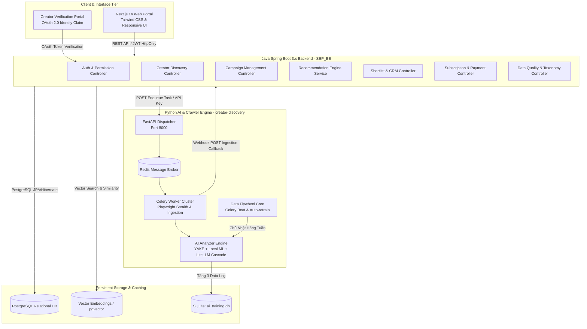
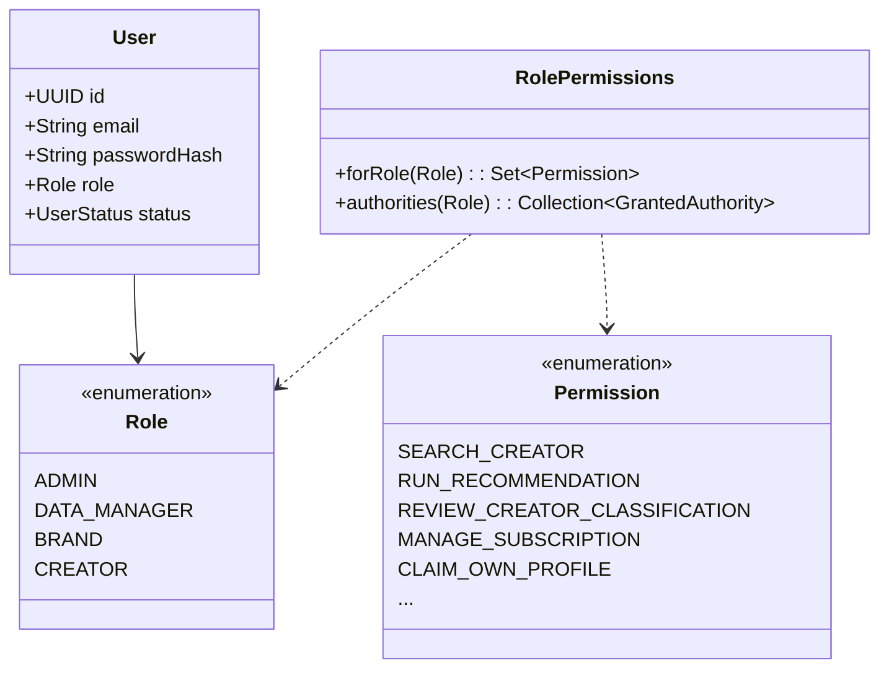
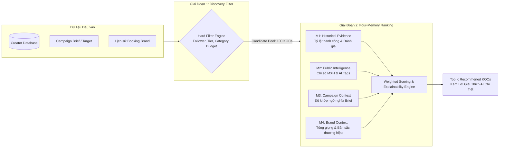
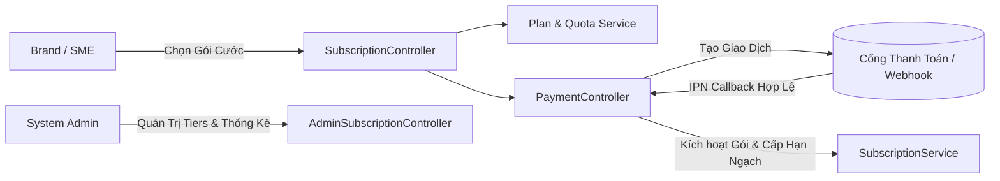
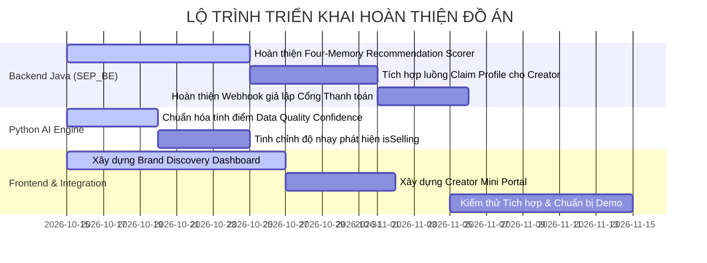

# 🏛️ Báo Cáo Phân Tích Kiến Trúc Hệ Thống & Đề Xuất Cải Tiến Kỹ Thuật (Enterprise B2B SaaS)

> **Dự án:** InfluencerMatch AI – Intelligent Influencer Discovery & Context-Aware Recommendation Platform for SMEs  
> **Căn cứ phân tích:** Mã nguồn Java Backend (`D:\SEP_BE`), Python AI & Crawler Engine (`d:\creator-discovery`), Đề cương Capstone mới nhất, và Kết quả phản biện Review 1.  
> **Mục tiêu tài liệu:** Tổng kết kiến trúc tổng thể, giải trình các quyết định kỹ thuật then chốt, chuẩn hóa quy trình phân quyền - dữ liệu - AI, và vạch rõ lộ trình kỹ thuật chi tiết hướng tới các cột mốc bảo vệ đồ án.

---

## 1. TỔNG QUAN HỆ THỐNG & TRIẾT LÝ THIẾT KẾ (SYSTEM OVERVIEW & DESIGN PHILOSOPHY)

Hệ thống được định vị là một nền tảng **B2B SaaS Enterprise-grade** hỗ trợ các doanh nghiệp vừa và nhỏ (SMEs) tìm kiếm, đánh giá và nhận đề xuất KOC/Influencer phù hợp nhất với ngữ cảnh chiến dịch và bản sắc thương hiệu.

### 1.1 Kiến trúc Hướng Dịch vụ (Microservices-oriented Architecture)
Hệ thống được chia tách mạch lạc thành 4 tầng kiến trúc chuyên biệt nhằm đảm bảo tính độc lập, khả năng chịu tải cao và tính sẵn sàng:



1. **Client Tier (Next.js 14):** Cung cấp giao diện làm việc trực quan cho Brand/SME, Bảng điều khiển Quản trị cho Admin / Data Manager, và Trang xác minh danh tính tối giản (Mini Portal) cho Creator.
2. **Core Enterprise Backend (Spring Boot 3.x):** Đóng vai trò hạt nhân điều phối toàn bộ nghiệp vụ doanh nghiệp: Quản lý bảo mật phân quyền hạt nhân, Quản lý chiến dịch, Xếp hạng đề xuất KOC, Quản lý thanh toán & gói cước.
3. **Asynchronous Crawler & AI Enrichment (FastAPI + Celery + Redis):** Tầng xử lý ngầm phi tập trung. Đảm bảo toàn bộ tác vụ nặng (cào dữ liệu Playwright, vượt anti-bot, trích xuất embedding, gọi LLM) chạy độc lập, không gây nghẽn HTTP thread của người dùng.
4. **Data & Storage Tier:** PostgreSQL quản lý dữ liệu quan hệ chặt chẽ; Vector Store lưu trữ biểu diễn không gian ngữ nghĩa của Creator và Campaign; SQLite lưu trữ nhật ký huấn luyện phục vụ Bánh đà Dữ liệu (Data Flywheel).

---

## 2. GIẢI QUYẾT BÀI TOÁN ACTOR & PHÂN QUYỀN DOANH NGHIỆP (ACTOR STRATEGY & ENTERPRISE RBAC)

### 2.1 Phản biện Review 1 & Thách thức Kiến trúc
Tại buổi Review 1, Hội đồng đưa ra 2 bài toán then chốt:
* **Vấn đề "God-Role Admin":** Hệ thống cũ dồn toàn bộ quyền quản trị người dùng, duyệt dữ liệu, cấu hình AI vào một tài khoản Admin duy nhất, vi phạm nguyên tắc an toàn thông tin (Separation of Concerns).
* **Vấn đề "Creator Consent & Data Provenance":** Việc chỉ dùng bot đi cào 100% dữ liệu công khai trên mạng mà không có sự tham gia của Creator bị đánh giá là thiếu tính xác thực chính chủ và tiềm ẩn rủi ro quyền riêng tư. Tuy nhiên, nếu xây dựng một sàn giao dịch 2 chiều hoàn chỉnh (Two-sided Marketplace) thì phạm vi đồ án sẽ vỡ trận và đối mặt bài toán "con gà - quả trứng" (Cold-start).

### 2.2 Kiến trúc Phân quyền Hạt nhân (Fine-Grained Permission-based RBAC)
Backend Java (`com.influencermatch.backend.security`) đã được tái thiết kế toàn diện, chuyển đổi từ phân quyền vai trò thô sơ (`hasRole`) sang **Phân quyền dựa trên Hành động cụ thể (`hasAuthority`)**:

* **Mô hình 4 Vai trò (Roles) tách bạch rõ ràng:**
  1. **`ROLE_ADMIN` (Quản trị Hệ thống):**
     * Quyền hạn: `VIEW_USER`, `ASSIGN_USER_ROLE`, `CHANGE_USER_STATUS`, `MANAGE_PLAN`, `MANAGE_SUBSCRIPTION`, `VIEW_AUDIT_LOG`, `MANAGE_RECOMMENDATION_CONFIG`.
     * Trách nhiệm: Giám sát toàn hệ thống, vận hành gói cước B2B SaaS, quản trị doanh thu và tài khoản. Không can thiệp vào nghiệp vụ duyệt dữ liệu hàng ngày.
  2. **`ROLE_DATA_MANAGER` (Kiểm duyệt & Chất lượng Dữ liệu):**
     * Quyền hạn: `VIEW_DATA_MONITORING`, `VIEW_COLLECTION_JOB`, `RETRY_COLLECTION_JOB`, `REFRESH_CREATOR_DATA`, `RESOLVE_CREATOR_DUPLICATE`, `RESOLVE_CREATOR_DATA_ISSUE`, `REVIEW_CREATOR_CLASSIFICATION`, `VIEW_DATA_OPERATION_LOG`.
     * Trách nhiệm: Đóng vai trò Human-in-the-Loop, kiểm duyệt các hồ sơ KOC bị AI gắn cờ tự tin thấp, quản lý cây phân loại danh mục (Taxonomy/Topics), đảm bảo dữ liệu đầu vào cho Recommendation luôn sạch.
  3. **`ROLE_BRAND` (Khách hàng Doanh nghiệp / SME):**
     * Quyền hạn: `SEARCH_CREATOR`, `CREATE_CAMPAIGN`, `RUN_RECOMMENDATION`, `MANAGE_OWN_SHORTLIST`, `MANAGE_OWN_RELATIONSHIP`, `RECORD_OWN_OUTCOME`, `RECORD_OWN_CREATOR_REVIEW`, `MANAGE_OWN_SUBSCRIPTION`, `VIEW_OWN_USAGE`.
     * Trách nhiệm: Sử dụng tính năng cốt lõi tìm kiếm KOC, tạo chiến dịch, nhận đề xuất từ AI, quản lý mối quan hệ hợp tác và ghi nhận kết quả.
  4. **`ROLE_CREATOR` (Mô hình Controlled Hybrid Actor):**
     * Quyền hạn: `CLAIM_OWN_PROFILE`, `UPDATE_OWN_RATE_CARD`, `VIEW_OWN_VERIFICATION_STATUS`.
     * **Quyết định thiết kế then chốt:** Creator **TUYỆT ĐỐI KHÔNG** được cấp quyền truy cập vào CRM, Shortlist, hay các phân tích chiến dịch nội bộ của Brand. Việc giữ phạm vi tối giản này giúp bảo mật chiến lược kinh doanh của Brand và giữ quy mô hệ thống tinh gọn.



### 2.3 Mô hình Xác thực Danh tính Controlled Hybrid & Creator Mini Portal
Để giải quyết bài toán Data Provenance mà không làm phình dự án thành sàn Marketplace:
1. **Dữ liệu mồi (Public Intelligence):** Crawler tự động thu thập thông tin công khai của Creator (TikTok, Facebook, YouTube) và lưu vào `Creator Master` với trạng thái `source_type = 'PUBLIC'` và `data_confidence` khởi điểm ở mức tiêu chuẩn.
2. **Kênh Xác thực (Creator Mini Portal):** Creator được cung cấp một cổng xác thực độc lập. Creator thực hiện đăng nhập qua OAuth 2.0 (Google OAuth / TikTok Login Kit).
3. **Đối soát Danh tính (Identity Matching):** Backend đối chiếu thông tin định danh (Kênh, Email, Social ID) do OAuth trả về với bản ghi trong Database. Khi trùng khớp, hệ thống kích hoạt liên kết tài khoản Role `CREATOR`.
4. **Nâng cấp Độ Tin Cậy (Verification Impact):** Hồ sơ lập tức chuyển thành `source_type = 'AUTHORIZED'`. Creator được bổ sung thông tin giá báo (Rate Card) và phương thức liên hệ chính chủ. Hồ sơ xuất hiện trên Discovery với huy hiệu **Verified Badge (Tick xanh)**, và trọng số tin cậy dữ liệu được đẩy lên mức tối đa (1.0).

---

## 3. KIẾN TRÚC TẦNG THU THẬP & LÀM GIÀU DỮ LIỆU AI (CRAWLER & AI HYBRID ENGINE)

Nằm trong repository `creator-discovery`, tầng này chịu trách nhiệm thu thập dữ liệu đa nền tảng và bóc tách ngữ nghĩa chuyên sâu.

### 3.1 Quy trình Thu thập Bất đồng bộ (Playwright Stealth & Ingestion Pipeline)
* **Playwright Stealth & Network Interception:** Thay vì cào DOM HTML truyền thống dễ bị gãy vỡ và dính Captcha, hệ thống sử dụng Playwright ở chế độ ngụy trang (Stealth) kết hợp cơ chế `page.route` để chặn bắt trực tiếp các luồng dữ liệu JSON API ngầm từ TikTok/Facebook. Điều này đảm bảo trích xuất chính xác 100% các chỉ số tương tác (Views, Likes, Comments, Shares) mà không phụ thuộc vào giao diện hiển thị.
* **Celery Distributed Workers:** Tách biệt tiếp nhận yêu cầu (`main.py` nhận REST request và trả về Job ID trong 10ms) với tiến trình thực thi cào ngầm. Hệ thống tự động Retry có giãn cách (Exponential Backoff) khi gặp sự cố mạng.

### 3.2 Bộ Não AI Đa Tầng (Teacher-Student Strategy)
Nhằm giải quyết triệt để bài toán **Chi phí API (Cost Optimization)** và **Độ ổn định hệ thống (High Availability)**, AI Analyzer (`app/ai/analyzer.py`) hoạt động theo chiến lược 3 tầng đan xen:

```mermaid
graph TD
    A[Dữ liệu KOC Thô: Bio + Captions + Hashtags] --> B[TẦNG 1: NLP Cổ Điển - YAKE N-grams]
    B -->|Trích xuất Tags & Cụm từ xu hướng| C[TẦNG 2: Local ML - Cây Quyết Định + Sentence-Transformers]
    
    C --> D{Local ML phân loại<br/>có tự tin cao?}
    D -->|YES - Độ tin cậy >= Ngưỡng| E[Gán Nhãn Category & Creator Type<br/>Chi phí: 0đ | Độ trễ: < 5ms]
    
    D -->|NO - Ra UNKNOWN hoặc mơ hồ| F[TẦNG 3: LiteLLM Multi-Cascade Engine]
    F -->|Thử Ưu Tiên 1| G[Google Gemini 1.5 Flash]
    G -.->|Lỗi 429 Hết Quota| H[Groq LLaMA 3.3 70B]
    H -.->|Lỗi Network/Down| I[OpenAI GPT-4o-mini]
    
    G --> J[Kết quả Phân Tích Chuẩn Xác + isSelling Detection]
    H --> J
    I --> J
    
    J --> K[(SQLite: ai_training.db)]
    E --> L[Đóng Gói Dữ Liệu Hoàn Chỉnh]
    J --> L
    
    M[Celery Beat Scheduler] -.->|2 AM Chủ Nhật| N[auto_update_prototypes.py]
    K -.->|Lấy dữ liệu nhãn chuẩn| N
    N -.->|Bơm từ khóa mới vào prototypes.json| C
```

1. **Tầng 1: NLP Cổ điển (YAKE N-grams):**
   * Trích xuất các cụm từ khóa thực sự có nghĩa (ví dụ: *"mỹ phẩm thuần chay"*, *"thời trang công sở"*) thay vì cắt vụn từng từ đơn lẻ.
2. **Tầng 2: Local Machine Learning (Học sinh - Xử lý 80% Dữ liệu):**
   * Sử dụng Decision Tree kết hợp Vector Embedding cục bộ (`Sentence-Transformers`) so khớp Cosine Similarity với tập tri thức `prototypes.json` nạp sẵn trên bộ nhớ RAM.
   * Ưu điểm: Phản hồi tức thì trong vài mili-giây, hoàn toàn miễn phí, xử lý trơn tru phần lớn hồ sơ KOC phổ biến.
3. **Tầng 3: Cloud LLM Multi-Cascade (Người Thầy - Bọc Lót 100%):**
   * Sử dụng thư viện `litellm` xây dựng cơ chế chịu lỗi tầng (Failover Cascade):
     * *Bước 1:* Gọi **Google Gemini 1.5 Flash** (Tối ưu chi phí, ngữ cảnh lớn).
     * *Bước 2:* Nếu gặp mã lỗi 429 (Rate Limit) -> Tự động trượt sang **Groq LLaMA 3.3 70B** (Tốc độ suy luận hàng đầu thế giới).
     * *Bước 3:* Nếu Groq gặp sự cố -> Trượt sang phương án dự phòng cuối **OpenAI GPT-4o-mini**.
   * Nhiệm vụ chuyên sâu: Phân loại các ca khó, bóc tách sắc thái nội dung và phát hiện mức độ chèo kéo thương mại (`isSelling: true/false`).
4. **Tầng 4: Bánh Đà Dữ Liệu (Data Flywheel - Tự Động Tiến Hóa):**
   * Mỗi kết quả do Tầng 3 giải quyết được lưu trữ vào SQLite (`ai_training.db`).
   * Định kỳ 2:00 AM Chủ Nhật, `Celery Beat` tự động kích hoạt script `auto_update_prototypes.py`, tổng hợp các từ khóa xu hướng mới và cập nhật ngược lại vào `prototypes.json`.
   * **Hiệu quả:** Tầng 2 ngày càng thông minh hơn qua từng tuần; tỷ lệ phải gọi Cloud LLM giảm dần theo thời gian, kéo chi phí vận hành về tiệm cận 0.

---

## 4. KIẾN TRÚC LÕI THUẬT TOÁN ĐỀ XUẤT (TWO-STAGE RECOMMENDATION & FOUR-MEMORY FRAMEWORK)

Hạt nhân học thuật của đồ án là Hệ thống Đề xuất Ngữ cảnh được phân tách thành 2 giai đoạn riêng biệt nhằm tối ưu hóa hiệu năng tính toán và độ chính xác:

### 4.1 Tách Bạch Rạch Ròi: Match Score vs Data Quality Confidence
Hệ thống loại bỏ hoàn toàn việc gán giá trị độ tin cậy tĩnh (`0.95`), thay vào đó định nghĩa rõ 2 chỉ số độc lập:
* **Match Score ($S_{match} \in [0, 100]$):** Đánh giá mức độ **phù hợp** của KOC đối với mục tiêu cụ thể của chiến dịch.
* **Data Quality Confidence ($C_{data} \in [0.0, 1.0]$):** Đánh giá mức độ **đáng tin cậy** của nguồn dữ liệu tạo nên điểm Match Score đó. Được tính toán từ 4 thành phần:
  $$C_{data} = w_1 \cdot C_{completeness} + w_2 \cdot C_{freshness} + w_3 \cdot C_{source} + w_4 \cdot C_{ai\_model}$$
  * *Completeness:* Mức độ đầy đủ của các trường thông tin (Bio, Contact, Follower, Engagement rate).
  * *Freshness:* Thời điểm thu thập dữ liệu gần nhất (áp dụng hàm suy giảm theo thời gian Time-decay).
  * *Source Reliability:* Nguồn xác thực chính chủ (`AUTHORIZED` = 1.0) so với nguồn cào công khai (`PUBLIC` = 0.7).
  * *AI Confidence:* Điểm tin cậy do mô hình phân loại trả về.

### 4.2 Giai Đoạn 1: Lọc Thô Khám Phá (Discovery & Hard Filtering)
* **Mục tiêu:** Giảm không gian tìm kiếm từ hàng chục ngàn KOC xuống một tập ứng viên rút gọn (`Candidate Pool` khoảng 50 - 200 KOC) trong thời gian dưới 50 mili-giây.
* **Cơ chế:** Sử dụng Dynamic SQL Specification / Elastic Query lọc cứng trên dữ liệu định lượng:
  * Nền tảng hoạt động (TikTok / YouTube / Facebook).
  * Khoảng Followers (Tier: Nano, Micro, Macro, Mega).
  * Ngưỡng Engagement Rate tối thiểu.
  * Ngân sách dự kiến (Estimated / Expected Fee).
  * Trùng khớp Danh mục lớn (Category).

### 4.3 Giai Đoạn 2: Chấm Điểm & Xếp Hạng Đa Tầng (Four-Memory Scoring Framework)
Tập ứng viên được đưa qua mô hình Four-Memory Framework nhằm tính toán điểm số tổng hợp:

$$\text{Final Score} = W_1 \cdot M_1 + W_2 \cdot M_2 + W_3 \cdot M_3 + W_4 \cdot M_4$$

Trong đó các trọng số $W_i$ được cấu hình linh hoạt từ Admin (`RecommendationConfig`):
1. **$M_1$ - Historical Evidence (Bằng chứng Lịch sử):** Đánh giá dựa trên hiệu quả thực tế từ các chiến dịch trước đó trong hệ thống (Tỷ lệ hoàn thành công việc, điểm review của Brand, ROI đạt được). 
   * *Xử lý Cold-Start:* Nếu KOC mới chưa có lịch sử ($M_1 = \text{null}$), thuật toán tự động tái phân bổ trọng số sang $M_2, M_3, M_4$ kèm nhãn cảnh báo minh bạch cho Brand.
2. **$M_2$ - Creator Public Intelligence (Hồ sơ Năng lực KOC):** Chỉ số tương tác thực tế, chất lượng người theo dõi, sự ổn định về tần suất đăng bài, tính xác thực của tài khoản.
3. **$M_3$ - Campaign Context Match (Độ Khớp Ngữ Cảnh Chiến Dịch):** So khớp ngữ nghĩa không gian vector giữa Campaign Brief (Mục tiêu, tệp khách hàng mục tiêu, thông điệp) với nội dung bài viết và phong cách thể hiện của KOC qua kỹ thuật Semantic Cosine Similarity.
4. **$M_4$ - Brand Context & Preference (Bản Sắc Thương Hiệu):** Đánh giá mức độ đồng điệu giữa tông giọng thương hiệu (Brand Tone & Style) với cá tính truyền thông của KOC.



### 4.4 Cơ Chế Học Liên Tục Hậu Chiến Dịch (Post-Campaign Continuous Learning via Vector EMA)
Thay vì sử dụng các mô hình Deep Learning phức tạp đòi hỏi retrain định kỳ tốn kém và đối mặt rủi ro "quên tri thức cũ" (Catastrophic Forgetting), hệ thống áp dụng phương pháp **Toán học Vector EMA (Exponential Moving Average)** để cập nhật vector đại diện $M_4$ của Brand sau mỗi chiến dịch hoàn tất:

$$\vec{V}_{Brand}^{(new)} = \alpha \cdot \vec{V}_{Brand}^{(old)} + (1 - \alpha) \cdot \vec{V}_{KOC\_Successful}$$

* **Ý nghĩa:** Trọng số $\alpha = 0.8$ giúp giữ lại 80% bản sắc thương hiệu cốt lõi, đồng thời hấp thụ 20% phong cách của KOC vừa mang lại hiệu quả cao trong chiến dịch.
* **Ưu điểm vượt trội:**
  * Thời gian cập nhật tức thì trong $1 \text{ ms}$ ngay khi Brand đánh giá chiến dịch.
  * Chi phí tính toán là **0 đồng**.
  * Hệ thống liên tục thông minh hơn, tự động thích ứng với sự thay đổi trong định hướng truyền thông của Brand.

---

## 5. KIẾN TRÚC THANH TOÁN & QUẢN TRỊ GÓI CƯỚC B2B SAAS (BILLING & SUBSCRIPTION MANAGEMENT)

Để đáp ứng đầy đủ tiêu chuẩn của một phần mềm thương mại dịch vụ (SaaS):



* **Phân tầng Gói cước (Pricing Tiers):** Hệ thống cấu hình sẵn 3 gói: *Starter (Miễn phí/Thử nghiệm)*, *Professional (Dành cho SME tăng trưởng)*, *Enterprise (Dành cho Agency lớn)*.
* **Quản trị Hạn ngạch (Quota Management):** Kiểm soát nghiêm ngặt các tài nguyên tính toán đắt đỏ:
  * Số lượt tạo Campaign bằng AI Brief / tháng.
  * Số lượt chạy Recommendation Engine / tháng.
  * Số lượng KOC được lưu trữ trong CRM / Shortlist.
  * Quyền xuất báo cáo phân tích chuyên sâu.
* **Quản trị Hệ thống (Admin Controls):** Controller `AdminSubscriptionController` cho phép quản trị viên xem tổng doanh thu định kỳ, điều chỉnh giá cước, cấp bù quota khi có sự cố kỹ thuật.

---

## 6. MA TRẬN TIẾN ĐỘ DỰ ÁN & KẾ HOẠCH HÀNH ĐỘNG (GAP ANALYSIS & ROADMAP)

Dựa trên việc kiểm tra chi tiết cả 2 codebase hiện tại:

### 6.1 Bảng Đánh Giá Hiện Trạng Kỹ Thuật (Status Matrix)

| Phân hệ / Tính năng | Hiện trạng triển khai | Repository | Mức độ hoàn thiện |
| :--- | :--- | :--- | :---: |
| **Hạ tầng Cào Dữ liệu (Playwright Stealth)** | Đã cào tốt TikTok/Facebook qua chặn bắt API ngầm, có Celery worker | `creator-discovery` | **90%** (Tốt) |
| **Phân tích AI Đa Tầng (Analyzer Engine)** | Đã tích hợp YAKE, Local Decision Tree, LiteLLM Cascade (Gemini/Groq/OpenAI) | `creator-discovery` | **95%** (Xuất sắc) |
| **Bánh đà Dữ liệu (Data Flywheel)** | Đã có SQLite log, script `auto_update_prototypes.py`, cấu hình Celery Beat | `creator-discovery` | **85%** (Hoạt động tốt) |
| **Ingestion Bridge (Giao tiếp Python - Java)** | Đã có endpoint Ingestion có Service Key bảo vệ tại `CreatorIngestionController` | `SEP_BE` | **90%** (Tốt) |
| **Bảo mật & Phân quyền RBAC Hạt nhân** | Đã hoàn thành 3 Roles, phân quyền Permission-based tại `RolePermissions.java` | `SEP_BE` | **85%** (Rất tốt) |
| **Quản trị Gói cước & Thanh toán** | Đã có Controller & Entity cho Plans, Subscriptions, Payments | `SEP_BE` | **70%** (Cần hoàn thiện luồng mock Webhook) |
| **Shortlist & Quan hệ KOC (Basic CRM)** | Đã có `ShortlistController`, `RelationshipController` | `SEP_BE` | **75%** (Đã có logic cơ bản) |
| **Core Recommendation Engine (Four-Memory)** | Đã có `CreatorDiscoverySpecification`, chưa hoàn thiện Four-Memory Scorer | `SEP_BE` | **40%** (Trọng tâm cần làm) |
| **Creator Mini Portal (OAuth Verification)** | Đã có hạ tầng Security OAuth, chưa ghép luồng Claim profile cho Creator | `SEP_BE` | **35%** (Cần triển khai theo thiết kế) |
| **Giao diện Người dùng (Frontend Web Portal)** | Đang trong giai đoạn thiết kế và ghép nối API | Frontend Repo | **30%** (Cần đẩy nhanh) |

### 6.2 Kế Hoạch Hành Động Ưu Tiên (Sprint Action Plan)



1. **Sprint 1 (Trọng tâm Học thuật - 10 ngày tới):**
   * Hoàn thiện lớp `RecommendationServiceImpl` trong `SEP_BE`: Lập trình công thức tính điểm Four-Memory, thuật toán EMA cập nhật $M_4$, và cơ chế tái phân bổ trọng số khi gặp Cold-Start.
   * Xóa bỏ hoàn toàn giá trị hardcode `0.95` trong `JavaMapper` của Python; triển khai công thức tính `Data Quality Confidence` tự động.
2. **Sprint 2 (Trọng tâm Nghiệp vụ B2B SaaS - 7 ngày tiếp theo):**
   * Xây dựng Endpoint `POST /api/v1/creators/claim` trên Java Backend, tích hợp xác thực Google OAuth 2.0.
   * Kết nối luồng kích hoạt Subscription và kiểm tra Quota khi Brand gọi API gợi ý KOC.
3. **Sprint 3 (Tích hợp & Trình diễn - 10 ngày cuối):**
   * Ghép nối toàn diện với Frontend Next.js: Discovery Search UI, Campaign Brief Generator, Creator Claim Screen.
   * Chuẩn bị kịch bản Demo trực tiếp với dữ liệu đã cào sẵn và dữ liệu xác thực thực tế.
