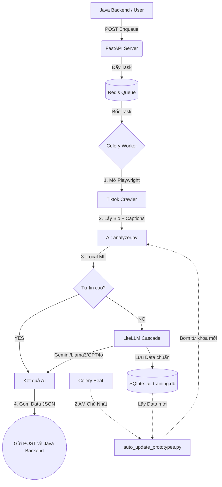

# 🚀 InfluencerMatch Crawler API - Kiến Trúc & Mã Nguồn (Phiên bản mới nhất)

Dưới đây là tài liệu kỹ thuật chi tiết nhất về toàn bộ Kiến trúc (Architecture) và Mã nguồn (Source Code) của hệ thống Crawler & AI sau khi đã được nâng cấp toàn diện với công nghệ **LiteLLM Cascade**, **YAKE N-grams**, và **Data Flywheel**.

---

## 1. KIẾN TRÚC TỔNG THỂ (OVERVIEW ARCHITECTURE)

Hệ thống được thiết kế theo mô hình **Microservices-oriented**, tách biệt hoàn toàn việc nhận Request, Cào dữ liệu, và Phân tích AI để đảm bảo khả năng chịu tải hàng ngàn KOC cùng lúc mà không bị treo Server. 

Bao gồm 4 Component chính:
1. **FastAPI Web Server (Tầng Giao Tiếp):** Nhận lệnh từ Java Backend hoặc User, đẩy lệnh vào hàng đợi Queue.
2. **Celery Background Workers (Tầng Cày Cuốc):** Những con Bot chạy ngầm, chia nhau công việc cào dữ liệu qua Playwright và gọi AI phân tích.
3. **AI Hybrid Engine (Tầng Não Bộ):** Bộ não kết hợp giữa Local ML (nhanh, miễn phí) và Cloud LLMs (thông minh, xử lý ca khó).
4. **Discovery Bot & Celery Beat (Tầng Tự Động Hóa):** Tự động đi săn KOC mới trên mxh, tự động retrain AI hàng tuần.

Hệ thống dùng **Redis** làm Message Broker trung gian.

---

## 2. KIẾN TRÚC AI ĐA TẦNG (HYBRID AI ARCHITECTURE)

Bộ não AI (`analyzer.py`) là trái tim của hệ thống. Thay vì tốn tiền gọi ChatGPT cho 100% KOC, hệ thống dùng chiến thuật **Teacher-Student (Thầy-Trò)** qua 3 tầng bảo vệ đan xen:

### Tầng 1: NLP Cổ điển (Xử lý mượt mà, Siêu tốc)
- **Công nghệ:** YAKE (N-grams).
- **Chức năng:** Trích xuất từ khóa (Tags). YAKE hiểu được tổ hợp từ liền kề, giúp giữ nguyên cụm từ có nghĩa như *"mỹ phẩm hàn quốc"* thay vì cắt nát thành *"mỹ", "phẩm", "hàn", "quốc"*.

### Tầng 2: Local Machine Learning (Trò - Miễn phí, Xử lý 80% Data)
- **Công nghệ:** Cây quyết định (Joblib) + Vector Embedding (Sentence-Transformers).
- **Chức năng:** Đoán Lĩnh vực lớn (Category) và Phân loại KOC (Creator Type). Đặc biệt, hệ thống dùng thuật toán **Cosine Similarity** so sánh đoạn Text của KOC với file `prototypes.json` trên RAM để tìm ra ngách (Niche) chuẩn nhất.
- **Ưu điểm:** Bọc lót ngay trên máy chủ nhà, thời gian phản hồi tính bằng mili-giây, không tốn 1 đồng API nào.

### Tầng 3: Cloud LLM - LiteLLM Multi-Cascade (Thầy - Bất tử 100%)
- **Công nghệ:** `litellm`
- **Chức năng:** Nếu Tầng 2 bó tay (ra `UNKNOWN`), hoặc cần bóc tách "Mùi chèo kéo bán hàng" (`isSelling: true`), Tầng 3 sẽ kích hoạt. 
- **Luồng Cascade (Phao cứu sinh):** 
  1. Gọi **Google Gemini 1.5 Flash** (Rẻ, Ưu tiên).
  2. Lỗi 429 Hết Quota? Tự động trượt qua **Meta Llama 3.3 70B** của Groq (Tốc độ đỉnh cao thế giới).
  3. Groq sập mạng? Tự động vớt vát bằng **OpenAI ChatGPT 4o-mini**.
- **Ưu điểm:** Hệ thống bất tử. Trừ khi 3 tập đoàn công nghệ lớn nhất thế giới sập cùng 1 lúc, nếu không KOC của bạn luôn được phân tích trọn vẹn.

### Tầng 4: Bánh Đà Dữ Liệu (Data Flywheel - Tự Tiến Hóa)
- Mỗi khi Tầng 3 (Cloud LLM) ra tay giải quyết một ca khó, kết quả chuẩn xác đó lập tức được lưu vào SQLite (`ai_training.db`).
- **Tự động Train:** 2 giờ sáng Chủ Nhật, `Celery Beat` tự kích hoạt script `auto_update_prototypes.py`, lôi đống Data chuẩn đó ra, ép ngược từ khóa mới vào file `prototypes.json` của Tầng 2.
- **Kết quả:** Tầng 2 (Trò) học được kiến thức mới từ Tầng 3 (Thầy). Tuần sau, Tầng 2 sẽ tự giải quyết được các KOC tương tự mà không cần nhờ vả Tầng 3 nữa. Chi phí AI giảm dần về 0 theo thời gian!

---

## 3. CẤU TRÚC MÃ NGUỒN CHI TIẾT (SOURCE CODE MAP)

### 📌 `main.py`
- Khởi tạo FastAPI Server. 
- Mở Endpoint `/api/v1/crawl/tiktok/enqueue`, dùng lệnh `.delay()` của Celery để tống việc vào hàng đợi, nhả kết quả ngay lập tức cho User đỡ phải chờ.
- Mở Endpoint `/api/v1/ai/retrain` cho phép kích hoạt bánh đà dữ liệu thủ công.

### 📌 `app/workers/tasks.py` & `celery_app.py`
- Định nghĩa file cấu hình Celery (kết nối Redis). Đặt lịch Celery Beat chạy vào Chủ nhật.
- Chứa task `@celery.task process_tiktok_profile`: Chịu trách nhiệm gọi Crawler -> Gọi AI Analyzer -> Đóng gói thành cục JSON phẳng -> Bắn POST Http Request sang cho Server Java. Tự động Retry nếu rớt mạng.

### 📌 `app/crawlers/tiktok_crawler.py`
- Tầng cào dữ liệu vô hình bằng **Playwright Stealth**. Không cào HTML thô sơ (dễ gãy), mà dùng kỹ thuật `page.route` chặn bắt (Intercept) ngầm các API JSON của TikTok để lấy view/like chuẩn 100%.

### 📌 `app/ai/analyzer.py`
- Nơi chứa logic đan xen 4 tầng AI kể trên. 
- Hàm `process_ai_enrichment()` là đạo diễn chính. Nó kiểm tra nếu độ tự tin của Local ML thấp, nó sẽ gom Bio + Caption tống thẳng vào Prompt, gửi cho `litellm` và ép trả về JSON chuẩn format (có trường `isSelling`).

### 📌 `app/scripts/auto_update_prototypes.py`
- Mảnh ghép cuối cùng của Data Flywheel. Truy xuất SQL lấy Data gán nhãn bởi Cloud LLM, dùng YAKE rút trích từ khóa xu hướng, trộn vào `prototypes.json`. Hoàn toàn tự động, không cần tắt mở Server.

---

## 4. BIỂU ĐỒ LUỒNG CHẠY THỰC TẾ (FLOWCHART)

Bản cập nhật này đưa hệ thống của bạn lên chuẩn **Enterprise-grade (Cấp độ Doanh nghiệp)**: Chịu lỗi cao (Fault-tolerant), Tự động hóa (Automated), và Tiết kiệm chi phí (Cost-optimized).
