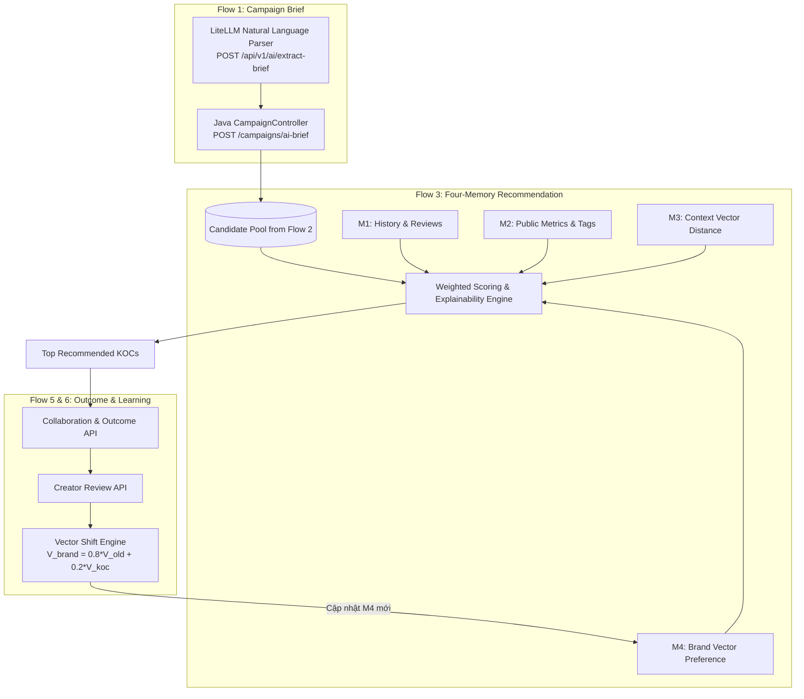

# 📋 Báo Cáo Đối Soát Hiện Trạng Mã Nguồn & Kế Hoạch Triển Khai Toàn Diện Các Flow Theo Proposal

> **Dự án:** InfluencerMatch AI – Intelligent Influencer Discovery and Recommendation Platform Based on Historical and Contextual Data for SMEs  
> **Căn cứ đối soát:** 
> 1. Mã nguồn Python AI & Crawler Engine (`d:\creator-discovery`)
> 2. Mã nguồn Java Backend Spring Boot (`D:\SEP_BE` – Nhánh `be_vy`)
> 3. Bản Đề cương Capstone Project Register mới nhất (7 Main Flows & 4 Actors)
> 
> **Mục tiêu tài liệu:** Đánh giá chi tiết hiện trạng mã nguồn, cung cấp đặc tả kỹ thuật cụ thể (Endpoints, DTOs, Services, Logic) cho các chức năng còn thiếu, thiết lập kế hoạch phân bổ công việc chi tiết cho 4 thành viên (Vy, Ngọc, Khải, Văn), và xây dựng lộ trình chuẩn bị bài báo Nghiên cứu Khoa học (NCKH).

---

## 1. BẢNG ĐỐI SOÁT HIỆN TRẠNG TOÀN DIỆN (STATUS MATRIX)

| STT | Flow Nghiệp Vụ / Actor | Tình Trạng Mã Nguồn Hiện Tại | Tỷ Lệ Hoàn Thành | Phân Hệ / Repo Chịu Trách Nhiệm | Điểm Nghẽn Kỹ Thuật & Việc Cần Làm |
| :---: | :--- | :--- | :---: | :---: | :--- |
| **1** | **Brand & Campaign Setup** | Đã có CRUD Campaign, vòng đời trạng thái (`DRAFT` $\to$ `ACTIVE`), lưu snapshot `CampaignContext`. | **80%** | `SEP_BE` & `creator-discovery` | **Thiếu:** Tính năng **AI Campaign Brief** (trích xuất văn bản tự nhiên sang form). |
| **2** | **Creator Discovery & Public Intelligence** | Đã cào TikTok/Facebook, Celery worker phân tán, Hybrid Search FTS + Vector 768d qua pgvector. | **90%** | Cả 2 repos | **Cần sửa:** Bỏ hardcode `0.95` trong `java_mapper.py`, tính **Data Quality Confidence** động. |
| **3** | **AI Recommendation (Four-Memory)** | Đã khai báo Permission, hạn ngạch `recommendationQuota`, chưa có Service tính điểm. | **30%** | `SEP_BE` (Chính) & `creator-discovery` | 🚨 **TRỌNG TÂM SỐ 1:** Xây dựng `RecommendationService` tính điểm $M_1 \to M_4$. |
| **4** | **Shortlist, Contact & Basic CRM** | Đã có `ShortlistController` (Priority/Notes) và `RelationshipController` (Stages: `CONTACTED` $\to$ `AGREED`). | **85%** | `SEP_BE` | **Thiếu:** Endpoint so sánh song song nhiều KOC trong Shortlist (`/compare`). |
| **5** | **Campaign Collaboration & Outcome** | Database đã có Entity & Table (`Collaboration`, `CampaignOutcome`, `CreatorReview`). | **40%** | `SEP_BE` | 🚨 **THIẾU:** Chưa có `CollaborationController` và `CollaborationService`. |
| **6** | **Post-Campaign Learning** | Chưa có logic cập nhật phản hồi và học liên tục sau chiến dịch. | **10%** | `SEP_BE` & `creator-discovery` | 🚨 **CẦN LÀM:** Thuật toán dịch chuyển Vector toán học **EMA** cập nhật gu Brand ($M_4$). |
| **7** | **Subscription & Payment Management** | Đã có Plans, Subscriptions, Payments, Quotas check. | **80%** | `SEP_BE` | **Cần hoàn thiện:** Mock Webhook IPN kích hoạt gói và reset hạn ngạch. |
| **--** | **Actor: Creator (Controlled Hybrid)** | Đã có hạ tầng Google OAuth 2.0; chưa có luồng liên kết Claim hồ sơ. | **25%** | `SEP_BE` | **Cần làm:** Thêm `Role.CREATOR`, API `POST /creators/{id}/claim` và cập nhật Rate Card. |
| **--** | **Actor: Data Manager (Human-in-the-Loop)** | Đã có Role & Permission; chưa có API hàng đợi duyệt KOC. | **60%** | `SEP_BE` | **Cần làm:** Endpoint lấy KOC có `dataConfidence < 0.7` để duyệt và sửa nhãn. |

---

## 2. ĐẶC TẢ KỸ THUẬT CHI TIẾT CÁC PHẦN CẦN TRIỂN KHAI



---

### FLOW 1: BRAND & CAMPAIGN SETUP (BỔ SUNG AI CAMPAIGN BRIEF)

#### 1. Hiện trạng:
* Java Backend (`CampaignController`) đã có CRUD cơ bản, nhập dữ liệu thủ công qua `CampaignRequest`.
* **Điểm thiếu:** Chưa hỗ trợ tính năng **AI Campaign Brief** (Doanh nghiệp nhập yêu cầu dạng văn bản tự nhiên, hệ thống tự động bóc tách thành các trường dữ liệu có cấu trúc).

#### 2. Đặc tả triển khai:
* **Tầng Python (`creator-discovery`):**
  * Tạo Endpoint tại router `app/api/routers/ai_router.py`:
    * `POST /api/v1/ai/extract-brief`
    * Body: `{"prompt": "Tôi cần tìm 3 bạn KOC nữ review son môi tại TP.HCM, ngân sách 20 triệu, kênh TikTok"}`
  * Logic: Dùng LiteLLM (Gemini 1.5 Flash) bóc tách JSON chuẩn:
    ```json
    {
      "name": "Chiến dịch Son Môi Nữ TP.HCM",
      "objective": "AWARENESS",
      "platforms": ["TIKTOK"],
      "niches": ["BEAUTY", "COSMETICS"],
      "targetAudiences": ["Nữ 18-24", "Gen Z"],
      "locations": ["TP.HCM"],
      "followerMin": 10000,
      "followerMax": 100000,
      "budgetMin": 10000000,
      "budgetMax": 20000000,
      "contentType": "VIDEO_REVIEW"
    }
    ```
* **Tầng Java Backend (`SEP_BE`):**
  * Thêm Endpoint tại `CampaignController.java`:
    ```java
    @PostMapping("/brands/{brandId}/campaigns/ai-brief")
    @PreAuthorize("hasAuthority('CREATE_CAMPAIGN')")
    public ResponseEntity<ApiResponse<CampaignResponse>> createWithAiBrief(
        @PathVariable UUID brandId,
        @Valid @RequestBody AiBriefPromptRequest request,
        Authentication auth);
    ```
  * Client Java gọi sang Python lấy JSON bóc tách $\to$ Tạo Campaign ở trạng thái `DRAFT` và nhả về cho Frontend điền sẵn lên form để Brand xem lại và chỉnh sửa.

---

### FLOW 2: CREATOR DISCOVERY & PUBLIC INTELLIGENCE (TÍNH CONFIDENCE ĐỘNG)

#### 1. Hiện trạng:
* Đã cào thành công TikTok/Facebook qua Playwright ngầm, phân tích AI và đẩy sang Backend Java lưu trữ.
* Trong [app/mappers/java_mapper.py](file:///d:/creator-discovery/app/mappers/java_mapper.py), trường `dataConfidence` đang bị gán cứng `0.95`.

#### 2. Đặc tả triển khai:
* **Tầng Python (`creator-discovery`):**
  * Xóa gán cứng `0.95`, viết hàm tính toán tự động dựa trên 4 chỉ số:
    $$C_{data} = 0.3 \cdot C_{completeness} + 0.3 \cdot C_{freshness} + 0.2 \cdot C_{source} + 0.2 \cdot C_{ai}$$
    * $C_{completeness}$: Đánh giá độ đầy đủ (Avatar: +0.25, Bio: +0.25, Email: +0.25, Chỉ số Engagement: +0.25).
    * $C_{freshness}$: Dựa trên ngày đăng bài gần nhất (trong 30 ngày = 1.0; 60 ngày = 0.8; $>90$ ngày = 0.5).
    * $C_{source}$: Nguồn cào DOM công khai = 0.7; Nguồn API chính thức = 0.9; Creator Claimed = 1.0.
    * $C_{ai}$: Điểm tự tin của mô hình AI phân loại (Local ML Cosine score hoặc LiteLLM confidence).
  * Kết quả: Trường `dataConfidence` bắn sang Java sẽ dao động thực tế từ $0.4 \to 1.0$.

---

### FLOW 3: AI RECOMMENDATION ENGINE (FOUR-MEMORY FRAMEWORK) – 🚨 TRỌNG TÂM CỐT LÕI

#### 1. Hiện trạng:
* Đã có quyền `RUN_RECOMMENDATION` và trường `recommendationQuota`.
* **Chưa có Controller và Service thực thi thuật toán Four-Memory.**

#### 2. Đặc tả triển khai (Java Backend `SEP_BE` & Python AI):
* **Tạo Package:** `com.influencermatch.backend.recommendation`
* **Tạo Controller:** `RecommendationController.java`
  ```java
  @RestController
  @RequestMapping("/campaigns/{campaignId}/recommendations")
  @RequiredArgsConstructor
  public class RecommendationController {
      private final RecommendationService recommendationService;

      @PostMapping("/run")
      @PreAuthorize("hasAuthority('RUN_RECOMMENDATION')")
      public ResponseEntity<ApiResponse<List<RecommendationResponse>>> run(
          @PathVariable UUID campaignId, Authentication auth);

      @GetMapping
      @PreAuthorize("hasAuthority('VIEW_OWN_RECOMMENDATION')")
      public ResponseEntity<ApiResponse<List<RecommendationResponse>>> getHistory(
          @PathVariable UUID campaignId, Authentication auth);
  }
  ```
* **Lập trình `RecommendationService` theo Four-Memory Framework:**
  1. **Bước 1 (Lấy Candidate Pool):** Gọi `CreatorDiscoveryService` lấy các KOC thỏa mãn Hard Filter (Nền tảng, Follower, Budget, Niche).
  2. **Bước 2 (Chấm điểm 4 Bộ nhớ):**
     * **$M_1$ - Historical Evidence ($w_1 = 0.30$):** Truy vấn từ bảng `campaign_outcome` và `creator_review` của KOC. Lấy điểm đánh giá trung bình và tỷ lệ hoàn thành KPI.
       * *Cơ chế Cold-Start:* Nếu KOC mới toanh ($M_1 = \text{null}$), tự động phân bổ lại trọng số sang $M_2, M_3, M_4$ và gắn cờ cảnh báo `isColdStart = true`.
     * **$M_2$ - Creator Public Intelligence ($w_2 = 0.30$):** Chuẩn hóa chỉ số tương tác (Engagement rate / Category average) kết hợp điểm uy tín dữ liệu $C_{data}$.
     * **$M_3$ - Campaign Context Fit ($w_3 = 0.25$):** Tính Cosine Similarity giữa Vector Campaign Brief 768 chiều và Vector Creator Metric.
     * **$M_4$ - Brand Context & Preference ($w_4 = 0.15$):** So khớp không gian vector giữa Vector KOC và Vector Brand Preference (lưu tại `brand_profile`).
  3. **Bước 3 (Tính điểm tổng hợp & Xếp hạng):**
     $$\text{Match Score} = (w_1 \cdot M_1 + w_2 \cdot M_2 + w_3 \cdot M_3 + w_4 \cdot M_4) \times 100$$
  4. **Bước 4 (Sinh AI Explanation):**
     * Gọi hàm sinh lời giải thích (từ Python hoặc mẫu template): *"Phù hợp 91%: KOC có tệp khán giả khớp 94% với ngành Mỹ phẩm (M3), tương tác ổn định 4.5% (M2), từng đạt kết quả tốt trong 2 chiến dịch trước (M1)."*
  5. **Bước 5 (Trừ Quota):** Tăng `usedRecommendationQuota` trong `Subscription` lên 1 lượt.
* **Tạo API Quản trị Trọng số cho Admin:**
  * Endpoint: `PUT /api/v1/admin/recommendation-config` (Quyền: `MANAGE_RECOMMENDATION_CONFIG`) để chỉnh sửa $W_1, W_2, W_3, W_4$ linh hoạt dưới Database.

---

### FLOW 4: SHORTLIST, CONTACT & BASIC CRM (BỔ SUNG SO SÁNH KOC)

#### 1. Hiện trạng:
* Đã có `ShortlistController` (thêm, xóa, ưu tiên priority) và `RelationshipController` (quản lý giai đoạn liên hệ: `CONTACTED` $\to$ `NEGOTIATING` $\to$ `AGREED`).

#### 2. Đặc tả triển khai:
* **Thêm API So sánh KOC trong Shortlist (`SEP_BE`):**
  * Endpoint: `POST /campaigns/{campaignId}/shortlist/compare`
  * Body: `{"creatorIds": ["uuid-1", "uuid-2", "uuid-3"]}`
  * Trả về bảng ma trận đối chiếu song song: Số Follower, Tỷ lệ tương tác, Điểm Match Score, Khoảng giá dự kiến (Estimated Fee), Điểm tin cậy dữ liệu và Danh sách 3 bài post tiêu biểu.

---

### FLOW 5: CAMPAIGN COLLABORATION & OUTCOME – 🚨 CẦN LÀM NGAY

#### 1. Hiện trạng:
* Đã có sẵn các bảng và Entity trong `com.influencermatch.backend.collaboration.model`:
  * `Collaboration` (Liên kết KOC được chọn, trạng thái hợp tác, phí thỏa thuận).
  * `CampaignOutcome` (Số liệu nghiệm thu: views, clicks, doanh thu thực tế).
  * `CreatorReview` (Đánh giá của Brand: số sao 1-5, mức độ Brand Fit, ghi chú).
  * `EvidenceAsset` (Lưu link bài viết, ảnh chụp bằng chứng nghiệm thu).
* **Chưa có Controller và Service.**

#### 2. Đặc tả triển khai:
* **Tạo `CollaborationController.java` (`SEP_BE`):**
  ```java
  @RestController
  @RequestMapping("/campaigns/{campaignId}/collaborations")
  @RequiredArgsConstructor
  public class CollaborationController {
      private final CollaborationService collaborationService;

      // 1. Chốt KOC vào chiến dịch (Agreed Fee & Booking)
      @PostMapping
      @PreAuthorize("hasAuthority('MANAGE_OWN_COLLABORATION')")
      public ResponseEntity<ApiResponse<CollaborationDto>> create(
          @PathVariable UUID campaignId, @Valid @RequestBody CreateCollabRequest req, Authentication auth);

      // 2. Nghiệm thu kết quả chiến dịch (Actual Views, Clicks, Post Link)
      @PostMapping("/{collabId}/outcome")
      @PreAuthorize("hasAuthority('RECORD_OWN_OUTCOME')")
      public ResponseEntity<ApiResponse<OutcomeDto>> recordOutcome(
          @PathVariable UUID collabId, @Valid @RequestBody RecordOutcomeRequest req, Authentication auth);

      // 3. Đánh giá chất lượng KOC sau chiến dịch
      @PostMapping("/{collabId}/review")
      @PreAuthorize("hasAuthority('RECORD_OWN_CREATOR_REVIEW')")
      public ResponseEntity<ApiResponse<ReviewDto>> submitReview(
          @PathVariable UUID collabId, @Valid @RequestBody SubmitReviewRequest req, Authentication auth);
  }
  ```
* Khi `submitReview` hoàn tất $\to$ Tự động bắn sự kiện kích hoạt **Flow 6 (Post-Campaign Learning)**.

---

### FLOW 6: POST-CAMPAIGN LEARNING (HỌC MÁY LIÊN TỤC VỚI VECTOR EMA)

#### 1. Hiện trạng:
* Chưa được lập trình ở bất kỳ repository nào.

#### 2. Đặc tả triển khai:
* **Tạo Service `PostCampaignLearningService.java` (`SEP_BE`):**
* Khi một Campaign chuyển sang trạng thái `COMPLETED` và có `CreatorReview`:
  1. **Lưu vết Lịch sử ($M_1$):** Cập nhật dữ liệu nghiệm thu vào bảng `campaign_outcome` để phục vụ các lần gợi ý sau.
  2. **Dịch chuyển Vector Gu Thương Hiệu ($M_4$ via Vector EMA):**
     * Lấy vector hiện tại của Brand: $\vec{V}_{Brand}^{(old)}$.
     * Lấy vector của các KOC được Brand chấm $\ge 4$ sao trong chiến dịch: $\vec{V}_{KOC}$.
     * Áp dụng công thức Exponential Moving Average:
       $$\vec{V}_{Brand}^{(new)} = 0.8 \cdot \vec{V}_{Brand}^{(old)} + 0.2 \cdot \vec{V}_{KOC}$$
     * Cập nhật vector mới vào bảng `brand_profile`.
  * **Hiệu quả:** Hệ thống tự động học gu thẩm mỹ của Brand theo thời gian thực (1ms), chi phí tính toán 0 đồng, không cần train lại Deep Learning.

---

### FLOW 7: SUBSCRIPTION & PAYMENT MANAGEMENT (MOCK WEBHOOK)

#### 1. Hiện trạng:
* Đã có đầy đủ Controller & Entity quản lý Plan, Subscription, Payment.
* **Cần hoàn thiện:** Endpoint nhận Webhook IPN giả lập kích hoạt gói:
  * Endpoint: `POST /api/v1/payments/webhook`
  * Logic: Nhận payload giao dịch thành công $\to$ Cập nhật `SubscriptionStatus = ACTIVE`, reset `usedRecommendationQuota = 0` và gia hạn 30 ngày sử dụng.

---

### CÁC TÁC VỤ VỀ ACTOR (CREATOR & DATA MANAGER)

#### 1. Actor Creator: Xác thực Danh tính (Controlled Hybrid & Mini Portal)
* **Trong `SEP_BE`:**
  * Bổ sung `ROLE_CREATOR` vào `Role.java`.
  * Khai báo quyền tại `RolePermissions.java`: `CLAIM_OWN_PROFILE`, `UPDATE_OWN_RATE_CARD`, `VIEW_OWN_PROFILE`.
  * Tạo Endpoint:
    ```java
    @PostMapping("/creators/{creatorId}/claim")
    @PreAuthorize("hasAuthority('CLAIM_OWN_PROFILE')")
    public ResponseEntity<ApiResponse<Void>> claimProfile(
        @PathVariable UUID creatorId, Authentication auth);
    ```
  * Logic: Creator đăng nhập qua Google OAuth. Đối chiếu Email Google với Email trong `public_creator_metric`. Nếu trùng khớp $\to$ Update `source_type = 'AUTHORIZED'`, gán `dataConfidence = 1.0` (Tick xanh) và cho phép nhập `verifiedBookingFee` (Rate Card).

#### 2. Actor Data Manager: Hàng Đợi Kiểm Soát Chất Lượng Dữ Liệu (Human-in-the-Loop)
* **Trong `SEP_BE`:**
  * Endpoint: `GET /admin/data-quality/pending` (Quyền: `REVIEW_CREATOR_CLASSIFICATION`) lấy danh sách các KOC có `dataConfidence < 0.7` hoặc Niche bị `UNKNOWN`.
  * Endpoint: `PUT /admin/data-quality/{id}/approve` cho phép Data Manager chỉnh sửa lại Niche và phê duyệt xuất hiện trên Discovery.

---

## 3. PHÂN CHIA NHIỆM VỤ CHI TIẾT THEO NHÂN SỰ (TASK ASSIGNMENT)

Nhóm gồm **3 bạn Backend/AI** (Vy, Ngọc, Khải) và **1 bạn Lead Frontend & Documentation** (Văn). Trong đó, **Vy và Ngọc phối hợp chặt chẽ (Co-working/Pair-programming)** trên các bài toán thuật toán và NCKH:

```
┌────────────────────────────────────────────────────────────────────────┐
│                        CẶP ĐÔI R&D THUẬT TOÁN & NCKH                   │
│                                                                        │
│   HUỲNH PHẠM NGUYÊN VY (Leader)     🤝     NGUYỄN THỊ YẾN NGỌC         │
│   - Core Backend Java (SEP_BE)             - AI & Data Engine (Python) │
│   - Four-Memory Recommendation             - AI Campaign Brief & Tags  │
│   - Post-Campaign Learning EMA             - Vector Embeddings & Fee   │
│   - Lead Thiết kế Thí nghiệm NCKH          - Benchmark Dataset NCKH    │
└───────────────────────────────────┬────────────────────────────────────┘
                                    │
        ┌───────────────────────────┴───────────────────────────┐
        ▼                                                       ▼
┌───────────────────────────────┐       ┌───────────────────────────────┐
│       VÕ PHẠM MINH KHẢI       │       │        NGUYỄN THẾ VĂN         │
│  (Business Backend & Actors)  │       │    (Lead Frontend & Docs)     │
│ - Collaboration & Outcome     │       │ - Dựng UI 6 Screen Next.js    │
│ - Creator Claim & Rate Card   │       │ - Map API toàn hệ thống       │
│ - Data Manager Quality Queue  │       │ - Feature Doc theo Screen     │
│ - Shortlist Compare & Payment │       │ - User Manual & UI Test       │
└───────────────────────────────┘       └───────────────────────────────┘
```

---

### 🤝 MÔ HÌNH PHỐI HỢP VY & NGỌC TRÊN 3 TASK TRỌNG TÂM

Vì **Task 1, 2, 3 của Vy** là phần giao thoa trực tiếp giữa **Toán học/AI (mảng của Ngọc)** và **Hệ thống Core Backend (mảng của Vy)**, hai bạn sẽ áp dụng mô hình Co-working / Pair-programming để đẩy nhanh tiến độ gấp đôi:

```
┌────────────────────────────────────────────────────────────────────────┐
│                        TASK 1: FOUR-MEMORY ENGINE                      │
├───────────────────────────────────┬────────────────────────────────────┤
│ 🐍 NGỌC (Tầng AI & Dữ liệu)       │ ☕ VY (Tầng Hệ Thống & Chấm Điểm)   │
│ - Chuẩn bị Vector M3 (Brief)      │ - Truy vấn Candidate Pool          │
│ - Chuẩn bị Vector M4 (Brand)      │ - Lấy lịch sử M1 & xử lý Cold-start│
│ - Viết Prompt sinh AI Explanation │ - Tính tổng hợp Match Score & Quota│
│ - Estimated Fee Range Engine      │ - Lưu bảng kết quả & Trừ Quota     │
└───────────────────────────────────┴────────────────────────────────────┘

┌────────────────────────────────────────────────────────────────────────┐
│                        TASK 2: VECTOR EMA LEARNING                     │
├───────────────────────────────────┬────────────────────────────────────┤
│ 🐍 NGỌC (Nghiên cứu & Thử nghiệm) │ ☕ VY (Triển khai & Lưu trữ)        │
│ - Test công thức toán học EMA     │ - Bắt sự kiện khi Campaign COMPLETED│
│   bằng Python/NumPy xem vector    │ - Tích hợp công thức EMA vào Java  │
│   có dịch chuyển đúng gu không    │ - Update vector mới vào Postgres   │
└───────────────────────────────────┴────────────────────────────────────┘

┌────────────────────────────────────────────────────────────────────────┐
│                        TASK 3: THỰC NGHIỆM NCKH                        │
├───────────────────────────────────┬────────────────────────────────────┤
│ 🐍 NGỌC (Benchmark & Metrics)     │ ☕ VY (Thiết kế & Lập Luận)         │
│ - Trích xuất tập Ground Truth     │ - Thiết kế các mô hình Baseline    │
│ - Viết script Python đo P@K, NDCG │ - Chạy Ablation Study (-M1, -M4)   │
│ - Xuất biểu đồ & bảng kết quả     │ - Viết nội dung bài báo khoa học   │
└───────────────────────────────────┴────────────────────────────────────┘
```

#### 🚀 Lợi thế của cách phối hợp này:
1. **Vy không bị quá tải:** Vy là Leader, vừa quản lý tiến độ vừa làm phần thuật toán khó nhất. Có Ngọc san sẻ phần Vector, Prompting và Benchmark giúp Vy tập trung vào kiến trúc Backend mà không bị ngợp.
2. **Khải tập trung 100% vào Business CRUD & Actors:** Khải toàn tâm toàn ý làm xong Flow 5 (Collaboration/Outcome), luồng Creator Claim và Data Manager Queue mà không bị phân tâm bởi thuật toán toán học.
3. **Văn yên tâm làm Frontend:** Văn có hợp đồng API (API Contract) rõ ràng từ Vy, Ngọc và Khải để dựng giao diện mượt mà cho 6 màn hình và chụp ảnh viết doc feature.

---

### PHÂN CÔNG CHI TIẾT TỪNG THÀNH VIÊN:

#### 1. HUỲNH PHẠM NGUYÊN VY (Leader – Core Backend Java & Nghiên Cứu Khoa Học)
*Phối hợp trực tiếp cùng Ngọc trên 3 Task cốt lõi:*

*   **Task 1 (Lõi đồ án - Flow 3): Xây dựng `RecommendationService` Four-Memory**
    *   **Repo:** `SEP_BE` (package `recommendation`).
    *   Tạo `RecommendationController` & `RecommendationService`.
    *   Viết logic tích hợp 4 bộ nhớ:
        *   $M_1$: Lịch sử booking & Creator review cũ (Xử lý Cold-start nếu KOC mới).
        *   $M_2$: Chỉ số MXH thực tế từ `PublicCreatorMetric`.
        *   $M_3$: Độ khớp ngữ nghĩa giữa Brief Vector và Creator Vector.
        *   $M_4$: So khớp tông giọng thương hiệu từ Brand Preference Vector.
    *   Tính tổng hợp `Match Score` theo trọng số ($W_1 \dots W_4$) và tự động trừ Quota trong `Subscription`.
*   **Task 2 (Lõi học máy - Flow 6): Thuật toán dịch chuyển Vector EMA hậu chiến dịch**
    *   **Repo:** `SEP_BE`.
    *   Khi Campaign `COMPLETED` và Brand đánh giá KOC tốt $\to$ Dịch chuyển vector của Brand: $\vec{V}_{Brand}^{(new)} = 0.8 \cdot \vec{V}_{Brand}^{(old)} + 0.2 \cdot \vec{V}_{KOC}$.
*   **Task 3 (NCKH Lead): Thiết kế Thực nghiệm & Đánh giá (Experiment Design)**
    *   Cấu hình các tham số và kịch bản thực nghiệm: Chạy **Ablation Study** (đo độ tụt giảm khi tắt lần lượt $-M_1, -M_2, -M_3, -M_4$) so với các Baseline cổ điển.
    *   Chủ trì viết các mục nội dung học thuật cho bài báo khoa học.

---

#### 2. NGUYỄN THỊ YẾN NGỌC (AI Engine, Crawler & Data Backend)
*Phụ trách toàn bộ "tầng não bộ" Python và đồng hành cùng Vy trên 3 Task cốt lõi:*

*   **Task 1 (Hỗ trợ Vy Task 1): Cung cấp tài nguyên AI cho Recommendation**
    *   **Repo:** `creator-discovery`.
    *   Đảm bảo API `/api/v1/ai/embed` sinh vector 768 chiều hoạt động ổn định, độ trễ thấp phục vụ so khớp $M_3$ và $M_4$.
    *   Viết logic sinh câu tóm tắt **AI Explanation** (dựa trên các thành phần điểm cao nhất của KOC) để trả về cho Backend.
    *   Xây dựng **Estimated Fee Range Engine** (ước lượng khoảng giá booking Min-Max dựa trên Follower Tier và Niche).
*   **Task 2 (Hỗ trợ Vy Task 2): Thử nghiệm toán học công thức Vector EMA**
    *   Viết script Python/NumPy kiểm chứng công thức dịch chuyển vector: Kiểm tra sau khi dịch chuyển với hệ số $\alpha = 0.8$, vector mới có thực sự tăng độ tương đồng với các KOC cùng gu không $\to$ Chốt công thức chuẩn cho Vy triển khai trên Java.
*   **Task 3 (Hỗ trợ Vy Task 3): Chuẩn bị Dữ liệu & Đo đạc Chỉ số NCKH**
    *   Trích xuất tập dữ liệu 300 KOC đa dạng các lĩnh vực; cùng Vy tạo bộ nhãn chuẩn Ground Truth.
    *   Viết script Python tính toán tự động các chỉ số đánh giá học thuật: **Precision@5, Precision@10, NDCG@10, MRR**.
*   **Task 4 (Độc lập - Flow 1 & 2): Hoàn thiện AI Brief & Data Confidence động**
    *   Tạo endpoint `POST /api/v1/ai/extract-brief` bóc tách văn bản tự nhiên sang JSON chiến dịch.
    *   Sửa `java_mapper.py`: Xóa hardcode `0.95`, tính điểm `dataConfidence` động theo 4 tiêu chí.

---

#### 3. VÕ PHẠM MINH KHẢI (Business Backend & Actor Systems)
*Phụ trách các luồng nghiệp vụ B2B SaaS, quản trị vòng đời chiến dịch và phân quyền Actor:*

*   **Task 1 (Flow 5): Viết Service & Controller cho Collaboration & Outcome**
    *   **Repo:** `SEP_BE` (package `collaboration`).
    *   Tạo `CollaborationController` và `CollaborationService` với 3 API:
        1. `POST /campaigns/{id}/collaborations`: Chốt hợp tác với KOC, nhập phí thỏa thuận (Agreed fee).
        2. `POST /collaborations/{id}/outcome`: Ghi nhận kết quả nghiệm thu (views, clicks, link bài viết).
        3. `POST /collaborations/{id}/review`: Brand đánh giá sao, nhận xét chất lượng KOC sau chiến dịch.
*   **Task 2 (Actor 3 - Creator): Xây dựng luồng Creator Claim Profile (Controlled Hybrid)**
    *   **Repo:** `SEP_BE` (`security` & `creator`).
    *   Thêm `ROLE_CREATOR` vào `Role.java` và khai báo quyền trong `RolePermissions.java`.
    *   Tạo API `POST /creators/{id}/claim`: Creator đăng nhập Google OAuth để nhận quyền sở hữu kênh $\to$ Nâng lên `source_type = 'AUTHORIZED'` (Tick xanh) và cho phép Creator nhập Rate Card mong muốn.
*   **Task 3 (Actor 4 - Data Manager): Hàng đợi duyệt dữ liệu rác (Human-in-the-Loop)**
    *   **Repo:** `SEP_BE`.
    *   Tạo API `GET /admin/data-quality/pending` lấy danh sách KOC có `dataConfidence < 0.7` và API `PUT /admin/data-quality/{id}/approve` cho Data Manager duyệt hoặc sửa Niche.
*   **Task 4 (Flow 4 & 7): API Compare KOC & Webhook Subscription**
    *   API `POST /campaigns/{id}/shortlist/compare` so sánh song song các KOC trong Shortlist.
    *   Hoàn thiện mock Webhook thanh toán kích hoạt gói cước.

---

#### 4. NGUYỄN THẾ VĂN (Lead Frontend Next.js & Feature Documentation)
*Phụ trách toàn bộ giao diện người dùng, kết nối toàn bộ API và viết tài liệu chức năng:*

*   **Task 1 (Frontend Next.js): Dựng UI & Map API cho 6 Screen Cốt Lõi:**
    1.  **Screen 1 - Brand Discovery:** Bộ lọc Dropdown Taxonomy, ô tìm kiếm, hiển thị danh sách thẻ KOC kèm Match Score, huy hiệu Tick xanh, nút thêm vào Shortlist.
    2.  **Screen 2 - Campaign Setup & AI Brief:** Form tạo chiến dịch thủ công + Tab "AI Brief" (Brand gõ văn bản tự nhiên $\to$ AI tự điền toàn bộ form).
    3.  **Screen 3 - AI Recommendation & Comparison:** Màn hình Top KOC được AI xếp hạng kèm câu giải thích AI Explanation và Bảng so sánh (Compare Table) các KOC trong Shortlist.
    4.  **Screen 4 - CRM & Collaboration:** Quản lý giai đoạn liên hệ KOC (`CONTACTED` $\to$ `AGREED`), Form nghiệm thu chiến dịch (nhập View, Like thực tế) và Form đánh giá Review KOC sau chiến dịch.
    5.  **Screen 5 - Creator Mini Portal:** Trang xác thực tối giản có nút "Đăng nhập Google để nhận hồ sơ", hiển thị trạng thái xác thực và ô cập nhật Giá booking mong muốn (Rate Card).
    6.  **Screen 6 - Data Manager Dashboard:** Bảng duyệt các KOC có độ tự tin thấp cho Data Manager bấm Duyệt/Sửa nhãn.
*   **Task 2 (Documentation): Viết Feature Documentation theo từng Screen**
    *   Chụp ảnh màn hình từng Screen kèm chú thích chi tiết: Input là gì, Output là gì, API nào đang được gọi, mã lỗi xử lý thế nào.
    *   Tài liệu này được định dạng chuẩn mực để làm trực tiếp **Chương 4 (Implementation & User Manual)** trong cuốn báo cáo đồ án Capstone.

---

## 4. KẾ HOẠCH BÀI BÁO NGHIÊN CỨU KHOA HỌC (NCKH)
### Hướng Nghiên Cứu: AI Decision-Support System for SME Influencer Selection (Hệ Thống Hỗ Trợ Ra Quyết Định B2B & Đánh Giá Thực Nghiệm)

Để bài báo có giá trị học thuật cao, được các hội nghị khoa học uy tín (IEEE, ACM, Scopus) chấp nhận và **không bị coi là bài báo thuần túy mô tả phần mềm CRUD**, nhóm triển khai theo mô hình **Bài Báo Toàn Diện (Integrated Paper: Kết hợp Kỹ thuật Hệ thống & Đánh giá Thực nghiệm Người dùng)**:

### 4.1 Câu Chuyện Nghiên Cứu & Cấu Trúc Khung Bài Báo
*   **Tên đề tài bài báo (Paper Title):**  
    > *"InfluencerMatch: An AI-Powered Context-Aware Decision-Support System for Influencer Selection in SMEs – An Empirical Evaluation"*  
    *(InfluencerMatch: Hệ thống thông minh hỗ trợ ra quyết định chọn Influencer theo ngữ cảnh cho doanh nghiệp SME – Đánh giá thực nghiệm)*
*   **Thông điệp khoa học (Core Message):**  
    Đối với các doanh nghiệp SME, việc tìm kiếm và lựa chọn KOC/Influencer thủ công (bằng Excel, lướt mạng xã hội) là một quy trình tốn nhiều thời gian, mệt mỏi về nhận thức và rủi ro cao. Bài báo chứng minh rằng: Một hệ thống hỗ trợ ra quyết định ứng dụng mô hình **Four-Memory Framework** kết hợp cơ chế học phản hồi liên tục (**Continuous Feedback Learning qua Vector EMA**) giúp **rút ngắn 70% thời gian ra quyết định, giảm đáng kể tải nhận thức (Mental Workload) và nâng cao chất lượng lựa chọn KOC có ý nghĩa thống kê ($p < 0.05$)**.

*   **Khung Cấu Trúc 7 Mục Chuẩn IEEE (6 - 8 Trang):**
    ```
    ├── Title: "InfluencerMatch: An Intelligent Decision-Support System with Four-Memory Recommendation..."
    ├── 1. INTRODUCTION: SME gặp khó khăn khi chọn KOC thủ công (tốn thời gian, rủi ro).
    ├── 2. RELATED WORK: Các giải pháp gợi ý KOC hiện nay và hạn chế của chúng.
    │
    ├── 3. PROPOSED SYSTEM & METHODOLOGY: (ĐÓNG GÓP KỸ THUẬT)
    │   ├── 3.1 Kiến trúc hệ thống tổng thể (Microservices-oriented & Cascade AI)
    │   ├── 3.2 Thuật toán Four-Memory Framework (M1, M2, M3, M4)
    │   └── 3.3 Cơ chế học liên tục qua Vector EMA (chi phí 0đ, thời gian 1ms)
    │
    ├── 4. EXPERIMENTAL EVALUATION: (ĐÓNG GÓP THỰC NGHIỆM NGƯỜI DÙNG)
    │   ├── 4.1 Thí nghiệm Người dùng (User Study): 30 Marketer chia 2 nhóm (Nhóm A tìm tay vs Nhóm B dùng AI)
    │   └── 4.2 Thước đo chuẩn hóa: Decision Time, Decision Quality, NASA-TLX Workload, TAM Trust
    │
    ├── 5. RESULTS & DISCUSSION:
    │   ├── 5.1 Kết quả User Study: Nhóm dùng AI giảm 70% thời gian, giảm tải nhận thức
    │   └── 5.2 Bảng Ablation Study ngắn: Chứng minh bật đủ M1-M4 cho kết quả tốt nhất
    │
    ├── 6. LIMITATIONS & FUTURE WORK: Cần mở rộng thêm đa nền tảng (Instagram, YouTube)
    ├── 7. CONCLUSION: Tổng kết đóng góp khoa học
    └── REFERENCES: 25 - 35 tài liệu tham khảo chuẩn IEEE/Scopus
    ```

---

### 4.2 Bốn Thành Phần Cốt Lõi Cần Chuẩn Bị (Vy + Ngọc)

```
┌────────────────────────────────────────────────────────────────────────┐
│                   4 TRỤ CỘT CHUẨN BỊ BÀI BÁO NCKH                      │
├───────────────────────────────────┬────────────────────────────────────┤
│ 1. THIẾT KẾ USER STUDY (A/B TEST) │ 2. ĐỐI TƯỢNG KHẢO SÁT THỰC TẾ      │
│ - Bài toán Scenario cụ thể        │ - N = 30 người có kinh nghiệm      │
│ - Nhóm A (15 người): Tìm tay      │ - Chủ shop online TikTok/Shopee    │
│ - Nhóm B (15 người): Dùng web AI  │ - Marketer trẻ & Agency booking    │
├───────────────────────────────────┼────────────────────────────────────┤
│ 3. 5 BỘ THƯỚC ĐO CHUẨN QUỐC TẾ   │ 4. KIỂM ĐỊNH THỐNG KÊ (p < 0.05)   │
│ - Decision Time (Bấm giờ phút)    │ - Independent Two-sample t-test    │
│ - Decision Quality (Chuyên gia)   │ - Mann-Whitney U test              │
│ - NASA-TLX (Tải nhận thức não)    │ - Bảng Ablation Study phụ trợ      │
│ - TAM (Tính hữu ích & Tin cậy)    │   (Khẳng định thuật toán vững chắc)│
└───────────────────────────────────┴────────────────────────────────────┘
```

1. **Thiết kế Thí nghiệm Đối chứng (Between-Subject Design):**
   * Cung cấp cùng 1 bài toán chiến dịch (Scenario): *"Hãy chọn ra 3 KOC phù hợp nhất cho chiến dịch ra mắt sản phẩm Son môi thuần chay, ngân sách 20 triệu, đối tượng nữ 18-24 tuổi trên TikTok."*
   * **Nhóm A (Nhóm đối chứng - 15 người):** Tự tìm kiếm thủ công theo cách truyền thống (lên TikTok/Facebook gõ từ khóa, dùng Google Trang tính ghi chép).
   * **Nhóm B (Nhóm thực nghiệm - 15 người):** Sử dụng hệ thống **InfluencerMatch AI** (nhập AI Brief, xem danh sách gợi ý xếp hạng Four-Memory và AI Explanation để chọn).
2. **Đối tượng tham gia khảo sát (Participants - Cỡ mẫu $N = 30$):**
   * 30 bạn trẻ có kinh nghiệm thực tế: Chủ shop online bán hàng thời trang/mỹ phẩm trên TikTok Shop/Shopee, Marketing Interns, Freelancers chuyên booking KOC, sinh viên năm cuối chuyên ngành Digital Marketing.
   * *Luận điểm bảo vệ tính hợp lệ:* Đề tài nhắm vào đối tượng **SME (doanh nghiệp nhỏ và vừa)**, nên các chủ shop và marketer thực chiến là đối tượng đại diện hoàn hảo nhất cho người dùng mục tiêu.
3. **Chuẩn bị 5 Thước đo Chuẩn Quốc tế:**
   * **Decision Time (Định lượng):** Đo bằng đồng hồ bấm giờ (phút). Kỳ vọng giảm từ $45\text{ phút} \to 10\text{ phút}$.
   * **Decision Quality (Định lượng):** Điểm đánh giá chất lượng danh sách 3 KOC được chọn (do 3 chuyên gia Marketing độc lập chấm trên thang 1-5).
   * **Cognitive Workload (NASA-TLX):** Thang đo tải nhận thức chuẩn quốc tế (Mental Demand, Temporal Demand, Effort, Frustration).
   * **Trust in AI (Độ tin tưởng):** Thang đo Likert 5 điểm đánh giá mức độ tin cậy vào lời giải thích AI Explanation.
   * **Technology Acceptance Model (TAM):** Đo 2 chỉ số kinh điển: *Perceived Usefulness (PU)* và *Perceived Ease of Use (PEOU)*.
4. **Phân tích Dữ liệu & Kiểm định Thống kê:**
   * Dùng Python (`scipy.stats`) chạy kiểm định **Independent Two-Sample t-test** (hoặc **Mann-Whitney U Test**).
   * Mục tiêu: Đạt chỉ số **$p\text{-value} < 0.05$** (chứng minh sự vượt trội của hệ thống là có ý nghĩa khoa học, không phải ngẫu nhiên).
   * Bổ trợ 1 bảng Ablation Study ngắn bóc tách Four-Memory ($M_1 \to M_4$) để khẳng định đóng góp thuật toán.

---

## 5. LỘ TRÌNH TRIỂN KHAI 4 SPRINT (GANTT ROADMAP)

```mermaid
gantt
    title LỘ TRÌNH TRIỂN KHAI TOÀN DIỆN DỰ ÁN CAPSTONE
    dateFormat  YYYY-MM-DD
    
    section SPRINT 1: LÕI THUẬT TOÁN & BRIEF
    Vy + Ngọc: Four-Memory Recommendation Scorer :active, 2026-10-15, 7d
    Ngọc: API AI Campaign Brief & Confidence động:active, 2026-10-15, 4d
    Khải: CollaborationController & Outcome API  :active, 2026-10-15, 6d
    Văn: Dựng UI Screen 1 (Discovery) & Screen 2 (Brief) :active, 2026-10-15, 7d

    section SPRINT 2: HỌC MÁY & ACTORS
    Vy + Ngọc: Vector EMA Continuous Learning    : 2026-10-22, 5d
    Khải: Creator Claim Profile qua OAuth & Rate Card : 2026-10-22, 5d
    Khải: Data Manager Queue & Shortlist Compare : 2026-10-25, 4d
    Văn: Dựng UI Screen 3 (Reco/Compare) & Screen 4 (CRM) : 2026-10-22, 6d

    section SPRINT 3: TÍCH HỢP & NCKH
    Vy + Ngọc: Chạy thực nghiệm Ablation Study & Đo P@K/NDCG : 2026-10-28, 6d
    Khải: Mock Webhook Payment & Hoàn thiện Quotas : 2026-10-28, 4d
    Văn: Dựng UI Screen 5 (Creator Portal) & Screen 6 (Data Mgr) : 2026-10-28, 5d
    Văn: Map toàn bộ API Backend & Chụp ảnh Screen Docs : 2026-10-31, 5d

    section SPRINT 4: KIỂM THỬ E2E & BÁO CÁO
    Cả nhóm: Kiểm thử End-to-End toàn bộ 7 Flow : 2026-11-05, 5d
    Vy + Văn: Hoàn thiện Báo cáo Capstone & Bài báo NCKH : 2026-11-08, 6d
```

---

### 💡 LỜI KHUYÊN VẬN HÀNH & PHỐI HỢP NHÓM:
*   **Văn (Frontend)** có thể bắt đầu code giao diện ngay bằng cách dùng dữ liệu Mock JSON trong lúc 3 bạn Backend hoàn thiện các API còn thiếu.
*   **Vy & Khải** ưu tiên viết xong `RecommendationController` và `CollaborationController` trong tuần đầu để tuần sau bắt đầu ghép nối và chạy thực nghiệm NCKH.
*   **Ngọc & Vy** liên tục trao đổi về format vector 768 chiều và schema của prompt AI Brief để đảm bảo hai bên giao tiếp mượt mà.

---

## 6. KẾT LUẬN & ĐỀ NGHỊ BÀN GIAO

1. **Về Kỹ thuật:** Toàn bộ kiến trúc và các API còn thiếu đã được đặc tả rõ ràng. Khoảng 70% khối lượng việc mới nằm ở tầng Backend Java (`SEP_BE`) để kết nối các Entity có sẵn thành các Service nghiệp vụ.
2. **Về Nhân sự:** Việc phân công cặp đôi **Vy + Ngọc** phụ trách lõi thuật toán/NCKH, **Khải** phụ trách các luồng nghiệp vụ/Actor, và **Văn** làm chủ Frontend/Documentation giúp công việc không bị chồng chéo, tận dụng tối đa thế mạnh của từng thành viên.
3. **Về Báo cáo & NCKH:** Nhóm đã có sẵn cấu trúc thí nghiệm rõ ràng, sẵn sàng thu thập số liệu thực tế để vừa đưa vào đồ án vừa viết bài báo khoa học chất lượng cao.
