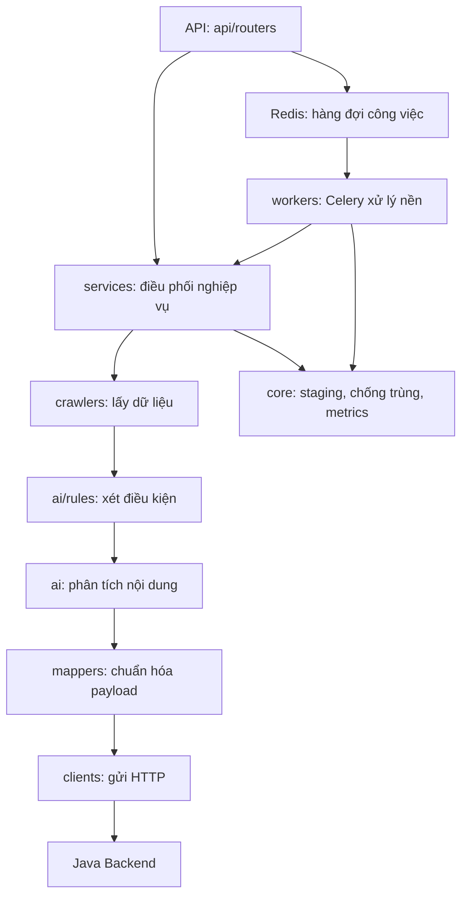

# Hướng dẫn cấu trúc và luồng xử lý project InfluencerMatch Crawler

Tài liệu này giải thích chức năng từng thư mục, vị trí triển khai nghiệp vụ và cách các thành phần phối hợp với nhau.

**Mốc đối chiếu:** code trong workspace ngày 16/11/2026, bao gồm các thay đổi đang có trên máy tại thời điểm viết. Một số file mới được tách ra có thể chưa nằm trong commit đã push. Tài liệu mô tả code hiện tại, không phải kết quả xác nhận mọi dịch vụ đã chạy thành công.

## 1. Project này làm gì?

Đây là dịch vụ Python tìm kiếm, thu thập và phân tích dữ liệu creator cho InfluencerMatch. Hệ thống nhận yêu cầu qua API hoặc tác vụ nền, tìm tài khoản trên mạng xã hội, kiểm tra điều kiện KOC/KOL, lấy thông tin và bài đăng, phân tích AI rồi gửi dữ liệu sang Java Backend.

Các phần việc chính:

1. Tìm creator mới theo từ khóa hoặc ngành hàng.
2. Crawl thông tin profile và bài đăng.
3. Sàng lọc tài khoản phù hợp, tài khoản bán hàng, spam hoặc thiếu bằng chứng.
4. Phân tích category, niche, loại creator, từ khóa và nội dung.
5. Tạo vector phục vụ tìm kiếm ngữ nghĩa.
6. Chuẩn hóa và đồng bộ dữ liệu sang Java.
7. Theo dõi trạng thái, hỗ trợ người quản lý duyệt và kiểm định.

## 2. Bản đồ thư mục

```text
Crawl data/
├── main.py                 Điểm khởi chạy API
├── app/                    Code ứng dụng
│   ├── api/routers/         Các API mà bên ngoài gọi vào
│   ├── services/           Điều phối các nghiệp vụ
│   ├── crawlers/           Truy cập mạng xã hội, lấy dữ liệu
│   ├── ai/                 Phân loại, kiểm tra bằng chứng, embedding
│   │   ├── rules/          Bộ luật xét duyệt KOC/KOL
│   │   ├── services/       Embedding và giải thích kết quả
│   │   ├── models/         Model ML đã huấn luyện
│   │   └── data/           Dữ liệu phục vụ AI
│   ├── workers/            Xử lý công việc nền bằng Celery
│   ├── core/               Model dữ liệu và tiện ích dùng chung
│   ├── mappers/            Chuyển dữ liệu sang định dạng Java
│   ├── clients/            Gọi HTTP sang Java Backend
│   ├── scripts/            Công cụ import, vận hành và bảo trì
│   └── ai_development/     Chuẩn bị dữ liệu, train và đánh giá ML
├── data/                   Dữ liệu vận hành trên máy
├── tests/                  Kiểm thử và đánh giá
├── docs/                   Tài liệu kiến trúc, nghiệp vụ
├── experiments/            Thử nghiệm thuật toán
└── venv/                   Môi trường Python
```



Sơ đồ thể hiện quan hệ tổng quát, không phải mọi request đều đi qua toàn bộ các bước. `crawlers` lấy dữ liệu; `services` phối hợp nghiệp vụ; `ai` phân tích và phân loại; `workers` thực thi công việc nền.

## 3. `main.py` — điểm khởi chạy

[Mở main.py](../main.py)

File này tạo ứng dụng FastAPI, cấu hình CORS, thiết lập lifecycle và gắn các router crawl, AI, review, monitor, quality.

Ví dụ chạy API:

```powershell
.\venv\Scripts\python.exe -m uvicorn main:app --port 8000
```

Uvicorn nạp biến `app` trong `main.py` để mở HTTP server. Logic nghiệp vụ chính nằm trong các module bên dưới `app/`.

## 4. `app/api/routers/` — lớp giao tiếp HTTP

Router quy định đường dẫn API, cấu trúc đầu vào, hàm xử lý và kết quả trả về.

| File | Nhiệm vụ |
|---|---|
| [crawl_router.py](../app/api/routers/crawl_router.py) | Crawl trực tiếp, enqueue ứng viên, crawl danh sách/ngành, kích hoạt discovery và refresh |
| [ai_router.py](../app/api/routers/ai_router.py) | Phân tích AI, tạo embedding, giải thích kết quả và kích hoạt cập nhật AI |
| [review_router.py](../app/api/routers/review_router.py) | Danh sách ứng viên chờ duyệt và quyết định duyệt/từ chối |
| [monitor_router.py](../app/api/routers/monitor_router.py) | Tổng quan crawl, hiệu suất và chi tiết hồ sơ |
| [quality_router.py](../app/api/routers/quality_router.py) | Chuẩn hóa ngành/ngách, từ chối, crawl lại và quản lý trạng thái xung đột danh tính |

Một số API crawl:

| API | Mục đích |
|---|---|
| `POST /api/v1/crawl/enqueue` | Đưa platform và username vào luồng preflight |
| `GET /api/v1/crawl/tiktok` | Crawl trực tiếp profile TikTok |
| `GET /api/v1/crawl/facebook` | Crawl trực tiếp Facebook |
| `GET /api/v1/crawl/instagram` | Crawl trực tiếp Instagram |
| `POST /api/v1/crawl/shortlist-trigger` | Kích hoạt crawl khi thêm creator vào shortlist |
| `POST /api/v1/crawl/trigger-weekly-discovery` | Kích hoạt tìm creator mới |
| `POST /api/v1/crawl/trigger-db-refresh` | Kích hoạt cập nhật creator đã có |

Khi thêm API, bắt đầu từ folder này rồi đưa phần phối hợp xử lý vào service. Hiện `quality_router.py` vẫn chứa khá nhiều logic nghiệp vụ và đọc/ghi file trực tiếp; mức độ tách lớp chưa đồng đều giữa các router.

## 5. `app/services/` — lớp điều phối nghiệp vụ

Một nghiệp vụ thường cần gọi crawler, bộ luật, AI, staging và Java client. Service ghép những bước này thành một chức năng hoàn chỉnh.

| File | Nhiệm vụ |
|---|---|
| [preflight_service.py](../app/services/preflight_service.py) | Kiểm tra trùng, lấy khóa, fetch sơ bộ, chạy luật và lưu quyết định |
| [ai_candidate_review.py](../app/services/ai_candidate_review.py) | Xin đánh giá bổ sung từ LLM và kiểm tra trích dẫn |
| [category_discovery_service.py](../app/services/category_discovery_service.py) | Chuyển ngành thành từ khóa, gọi discovery TikTok/Facebook |
| [live_crawl_service.py](../app/services/live_crawl_service.py) | Điều phối crawl trực tiếp, đánh giá và ghi kết quả |
| [live_fetcher_service.py](../app/services/live_fetcher_service.py) | Chọn cách lấy dữ liệu theo platform, chuẩn hóa đầu ra cho live crawl |
| [live_sync_service.py](../app/services/live_sync_service.py) | Phân tích AI, lưu local và đồng bộ luồng live sang Java |
| [shortlist_crawl_service.py](../app/services/shortlist_crawl_service.py) | Crawl và đồng bộ creator từ shortlist |
| [crawled_result_service.py](../app/services/crawled_result_service.py) | Đọc, chuẩn hóa, lọc và tìm kết quả crawl local |

### Ví dụ: preflight hoạt động như thế nào?

1. Chuẩn hóa username.
2. Kiểm tra cooldown và điều kiện xử lý lại.
3. Lấy khóa Redis để tránh hai worker xử lý cùng tài khoản.
4. Gọi preflight fetcher theo nền tảng.
5. Đưa profile và bài preview vào `RuleEngine`.
6. Một số hồ sơ chưa rõ được AI đánh giá bổ sung.
7. Lưu quyết định, lý do và bằng chứng vào staging.
8. Giải phóng khóa.

`ai_candidate_review.py` không tự biến một hồ sơ mơ hồ thành hồ sơ được tự động chấp nhận. Khi có bằng chứng phù hợp, nó đưa hồ sơ về trạng thái cần người quản lý xem xét.

Luồng refresh có nhánh xử lý riêng; không nên mặc định rằng nó áp mọi điều kiện giống ứng viên mới.

## 6. `app/crawlers/` — lớp lấy dữ liệu mạng xã hội

Folder này mở trình duyệt, tải trang, đọc HTML/JSON, bóc profile, follower, caption và tương tác. Nó cũng xử lý các vấn đề đặc thù như popup, phiên đăng nhập và dữ liệu phản hồi mạng.

| File | Nhiệm vụ |
|---|---|
| [tiktok_crawler.py](../app/crawlers/tiktok_crawler.py) | Crawl profile và bài đăng TikTok, lấy dữ liệu từ DOM và phản hồi mạng |
| [facebook_crawler.py](../app/crawlers/facebook_crawler.py) | Chuẩn hóa username Facebook, xử lý popup, lấy profile và bài đăng |
| [instagram_crawler.py](../app/crawlers/instagram_crawler.py) | Crawl profile và bài đăng Instagram |
| [preflight_fetcher.py](../app/crawlers/preflight_fetcher.py) | Lấy dữ liệu sơ bộ và thông tin tác giả TikTok |
| [search_extractor.py](../app/crawlers/search_extractor.py) | Bóc ứng viên từ HTML kết quả tìm kiếm, lọc search card |
| [tiktok_discovery.py](../app/crawlers/tiktok_discovery.py) | Tìm ứng viên TikTok theo từ khóa, kiểm tra liên quan chủ đề |
| [facebook_discovery.py](../app/crawlers/facebook_discovery.py) | Tìm ứng viên Facebook |
| [discovery_crawler.py](../app/crawlers/discovery_crawler.py) | Đầu mối import chức năng discovery theo nền tảng |

Phân biệt hai công việc:

- **Discovery:** chưa có username, cần tìm tài khoản mới. Ví dụ: tìm creator về mỹ phẩm.
- **Profile crawl:** đã có username, cần lấy chi tiết. Ví dụ: lấy profile và bài đăng của `@abc`.

Khi nền tảng đổi giao diện làm mất follower hoặc bài đăng, kiểm tra crawler tương ứng trước.

Code hiện tại có crawler TikTok, Facebook và Instagram. Enum và một số mô tả có nhắc YouTube, nhưng chưa thấy module crawler YouTube tương ứng trong cây file hiện tại.

## 7. `app/ai/` — phân tích và bổ sung thông tin

AI của project kết hợp model ML local, so khớp ngữ nghĩa, quy tắc và LLM.

| File | Nhiệm vụ |
|---|---|
| [analyzer.py](../app/ai/analyzer.py) | Điều phối pipeline phân tích: text, category, niche, creator type, LLM và kết quả enrichment |
| [creator_classifier.py](../app/ai/creator_classifier.py) | Phân loại bổ sung bằng tín hiệu nội dung và thông tin tài khoản |
| [grounded_enrichment.py](../app/ai/grounded_enrichment.py) | Tạo mô tả từ nguồn thật, kiểm tra bằng chứng và nhóm sản phẩm |
| [fallback_labels.py](../app/ai/fallback_labels.py) | Kiểm tra, chuẩn hóa nhãn fallback |
| [model_manager.py](../app/ai/model_manager.py) | Nạp và dùng chung model `.joblib` |
| [config.py](../app/ai/config.py) | Ngưỡng và cấu hình suy luận |
| [schemas.py](../app/ai/schemas.py) | Cấu trúc kết quả dự đoán, confidence và engine |
| [training_db.py](../app/ai/training_db.py) | Lưu dữ liệu phục vụ phát triển/cập nhật AI |

### Pipeline phân tích

Hàm trung tâm:

```python
process_ai_enrichment(creator_info, recent_posts)
```

Các bước chính:

1. Ghép bio và caption thành văn bản.
2. Dự đoán category bằng pipeline local.
3. Dự đoán niche.
4. Dự đoán creator type.
5. Trích xuất từ khóa.
6. Tạo phần mô tả từ nội dung công khai.
7. Gọi LLM bổ sung nhãn, tags, topic và nhóm sản phẩm.
8. Kiểm tra bằng chứng trước khi nhận một số nhãn.
9. Trả `AIEnrichment`.

**Hành vi hiện tại:** dù comment mô tả gọi LLM khi cần fallback, các biến sau phần điều kiện đang được gán để gọi LLM cho mọi hồ sơ có văn bản. Vì vậy không chỉ các ca ML thất bại mới gọi LLM.

### Kiểm tra bằng chứng

`grounded_enrichment.py`:

- Ghép mô tả từ đoạn bio/caption thực tế.
- Loại bỏ một số thông tin liên hệ.
- Kiểm tra trích dẫn có tồn tại trong nguồn.
- Giới hạn nhóm sản phẩm trong danh sách cho phép.
- Yêu cầu bằng chứng riêng cho từng nhóm, tối đa ba nhóm.

Kiểm tra trích dẫn tồn tại là một lớp bảo vệ; tự nó chưa chứng minh trích dẫn đủ sức hỗ trợ mọi kết luận ngữ nghĩa.

## 8. `app/ai/rules/` — bộ luật xét điều kiện

| File | Nhiệm vụ |
|---|---|
| [rule_config.py](../app/ai/rules/rule_config.py) | Quyết định, trạng thái, ngưỡng và cụm từ nhận diện |
| [signal_extractor.py](../app/ai/rules/signal_extractor.py) | Chuyển bio/bài đăng thành tín hiệu và số liệu |
| [rule_engine.py](../app/ai/rules/rule_engine.py) | Quyết định nhận, loại, chờ duyệt hoặc thử lại |
| [post_validator.py](../app/ai/rules/post_validator.py) | Kiểm tra dữ liệu sau crawl sâu |

```text
Bio + caption
→ Trích tín hiệu: review, ý kiến, bán hàng, chuyên môn…
→ Áp bộ luật
→ Decision + primary_type + reason_codes + evidence
```

Các quyết định chính:

| Quyết định | Ý nghĩa |
|---|---|
| `AUTO_ACCEPT_KOC` | Tự động chấp nhận theo nhánh KOC |
| `AUTO_ACCEPT_KOL` | Tự động chấp nhận theo nhánh KOL |
| `AUTO_REJECT` | Tự động loại |
| `NEEDS_MANAGER_REVIEW` | Cần người quản lý xem xét |
| `SKIP_INSUFFICIENT` | Chưa đủ dữ liệu để tiếp tục |
| `RETRY_PREFLIGHT` | Cần thử preflight lại |
| `MANAGER_APPROVED` | Người quản lý đã duyệt |

Phân biệt:

- `creatorType` hoặc `primary_type`: tài khoản thuộc loại nào.
- `decision`: hệ thống sẽ làm gì với hồ sơ.
- `processing_status`: công việc đang ở giai đoạn nào.

Một tài khoản có thể được đánh giá nghiêng về KOC nhưng vẫn phải chờ manager review.

Bộ luật xét số bài preview, tỷ lệ review, nhận xét cụ thể, chuyên môn và tín hiệu ảnh hưởng. Có nhánh Tier-0 khi không lấy được bài đăng, nên không phải mọi quyết định chấp nhận đều dựa trên đủ năm bài preview.

`post_validator.py` kiểm tra tiếp sau crawl sâu: định danh, follower, số bài và dấu hiệu bán hàng dạng catalog. Tiêu chí phân loại còn xuất hiện trong `creator_classifier.py` và worker; khi sửa cần đối chiếu các lớp này.

## 9. Các folder con phục vụ AI

### `app/ai/services/`

| File | Nhiệm vụ |
|---|---|
| [embedding_service.py](../app/ai/services/embedding_service.py) | Chuyển text thành vector |
| [explanation_service.py](../app/ai/services/explanation_service.py) | Tính điểm thành phần và giải thích mức phù hợp của creator |

Embedding có hai hướng sử dụng:

| Model | Mục đích |
|---|---|
| `paraphrase-multilingual-MiniLM-L12-v2` | Phân loại và so khớp ngữ nghĩa nội bộ |
| `bkai-foundation-models/vietnamese-bi-encoder` | Vector tìm kiếm 768 chiều cho query và hồ sơ creator |

Ví dụ, câu “review skincare cho da dầu” được chuyển thành vector để so độ gần nghĩa với nội dung creator. Cần đọc thêm Java Backend để biết đầy đủ cách lưu vector, truy vấn và xếp hạng cuối cùng.

### `app/ai/models/`

Chứa model đã huấn luyện:

```text
models/
├── category/       Model dự đoán ngành
└── creator_type/   Model dự đoán loại creator
```

`model_manager.py` nạp các model và thông tin nhãn liên quan.

### `app/ai/data/`

- `prototypes.json`: mô tả và từ khóa mẫu phục vụ phân loại/so khớp.
- `ai_training.db`: dữ liệu phục vụ phát triển AI.

## 10. `app/workers/` — xử lý nền bằng Celery

| File | Nhiệm vụ |
|---|---|
| [celery_app.py](../app/workers/celery_app.py) | Redis, queue, concurrency và lịch tác vụ |
| [tasks.py](../app/workers/tasks.py) | Các công việc crawl, discovery, refresh và cập nhật AI |
| [crawl_pacing.py](../app/workers/crawl_pacing.py) | Giãn khoảng cách bắt đầu task crawl |

API đưa việc vào queue; worker lấy việc ra để chạy, giúp request không phải chờ toàn bộ crawl và AI.

Các task chính:

- `preflight_candidate_task`.
- `process_tiktok_profile`.
- `process_facebook_profile`.
- `process_instagram_profile`.
- `weekly_discover_new_creators_task`.
- `auto_refresh_creators_in_db_task`.
- `run_retrain_pipeline`.

Hai queue quan trọng:

```text
preflight_queue   → sàng lọc ban đầu
deep_crawl_queue  → crawl chi tiết
```

Worker crawl sâu kiểm tra lại staging để chặn tác vụ chưa được cho phép, với nhánh riêng cho refresh.

`crawl_pacing.py` mặc định giãn nhịp 30–45 giây, cấu hình qua `CRAWL_TASK_MIN_INTERVAL` và `CRAWL_TASK_MAX_INTERVAL`. Cơ chế này chia sẻ trong một process worker, chưa phải bộ giới hạn toàn cục cho nhiều máy.

`celery_app.py` khai báo lịch discovery, refresh và cập nhật AI. Muốn phát task đúng lịch phải có **Celery Beat** chạy. Chỉ chạy Celery Worker chưa đủ.

Tên `run_retrain_pipeline` cần đọc cùng implementation: hiện task gọi cập nhật prototypes, chưa chạy toàn bộ quy trình train lại `.joblib`.

## 11. `app/core/` — nền tảng dùng chung

| File | Nhiệm vụ |
|---|---|
| [models.py](../app/core/models.py) | Cấu trúc dữ liệu chuẩn |
| [candidate_staging.py](../app/core/candidate_staging.py) | Lưu trạng thái, quyết định và bằng chứng ứng viên |
| [deduplicator.py](../app/core/deduplicator.py) | Chống trùng, khóa Redis và cooldown |
| [confidence.py](../app/core/confidence.py) | Tính độ tin cậy dữ liệu |
| [fee_benchmark.py](../app/core/fee_benchmark.py) | Ước tính khoảng phí theo follower |
| [metrics_tracker.py](../app/core/metrics_tracker.py) | Chỉ số vận hành crawler |
| [logger.py](../app/core/logger.py) | Log console và `server.log` |

### Cấu trúc dữ liệu chung

```text
CreatorInfo    Thông tin tài khoản
Post           Một bài đăng
AIEnrichment   Kết quả phân tích AI

IngestPayload
├── creator
├── recentPosts
├── aiEnrichment
├── source
├── crawlRunId
└── thời điểm thu thập
```

`IngestPayload` giúp các crawler trả cùng một định dạng. Nó còn tính trung bình views, likes, comments, shares và engagement rate.

Staging lưu hồ sơ cùng quyết định, lý do, bằng chứng, số lần retry và thời điểm kiểm tra. Implementation hiện dùng SQLite tại `data/candidate_staging.db`. Comment có nhắc PostgreSQL nhưng repository hiện tại không vì thế mà đang sử dụng PostgreSQL.

## 12. `app/mappers/` và `app/clients/` — kết nối Java

### `app/mappers/java_mapper.py`

[JavaMapper](../app/mappers/java_mapper.py) chuyển `IngestPayload` sang định dạng Java cần:

- Đổi tên và chuẩn hóa trường, ví dụ `username` → `userName`.
- Chuẩn hóa username.
- Tính chỉ số tương tác.
- Tính `dataConfidence`.
- Ước tính phí tham khảo.
- Ghép văn bản và tạo embedding tìm kiếm.
- Đưa bài đăng vào payload.

### `app/clients/java_client.py`

[JavaClient](../app/clients/java_client.py) gửi HTTP POST:

- Đọc endpoint từ `JAVA_BACKEND_URL`.
- Gửi `X-Service-Key` từ cấu hình.
- Kiểm tra status HTTP.
- Kiểm tra Java có trả `REJECTED` không.
- Trả kết quả thành công/thất bại.

```text
IngestPayload
→ JavaMapper: chuyển định dạng, tính trường bổ sung
→ JavaClient: gửi HTTP
→ Java Backend: tiếp nhận và xử lý
```

Java thay schema thì kiểm tra mapper. Lỗi kết nối, endpoint hoặc xác thực thì kiểm tra client và cấu hình môi trường.

## 13. `app/scripts/` — công cụ chạy độc lập

| Script | Nhiệm vụ |
|---|---|
| [import_and_crawl_excel.py](../app/scripts/import_and_crawl_excel.py) | Import Excel/CSV, gửi trực tiếp hoặc enqueue crawl |
| [crawl_recent_posts_worker.py](../app/scripts/crawl_recent_posts_worker.py) | Bổ sung bài đăng; có thao tác cập nhật và xóa DB ở một số trường hợp |
| [smart_reclassify_creators.py](../app/scripts/smart_reclassify_creators.py) | Phân loại lại creator hiện có |
| [audit_existing_creators.py](../app/scripts/audit_existing_creators.py) | Kiểm định dữ liệu DB, xuất đề xuất và có chế độ xuất SQL |
| [auto_update_prototypes.py](../app/scripts/auto_update_prototypes.py) | Bổ sung từ khóa prototypes từ dữ liệu đã lưu |
| [connect_facebook.py](../app/scripts/connect_facebook.py) | Hỗ trợ đăng nhập và lưu phiên Facebook |

Đây là các đường chạy độc lập, có thể gọi trực tiếp DB/backend và không nhất thiết đi qua đầy đủ API → preflight → worker. Khi điều tra một hồ sơ, cần xác định nó đến từ luồng nào.

## 14. `app/ai_development/` — xây dựng model ML

| File | Nhiệm vụ |
|---|---|
| `01_prepare_dataset.py` | Chuẩn bị dữ liệu huấn luyện |
| `02_check_training_readiness.py` | Kiểm tra dữ liệu đủ điều kiện train |
| `03_build_category_gold_test.py` | Tạo tập kiểm thử chuẩn category |
| `04_train_category_model.py` | Train category bằng Logistic Regression |
| `05_evaluate_category_model.py` | Đánh giá model category |
| `05_train_creator_type_model.py` | Train model creator type |
| `06_tune_unknown_threshold.py` | Chọn ngưỡng trả `UNKNOWN` |
| `07_export_category_model.py` | Đưa model category từ bản thử nghiệm sang nơi ứng dụng dùng |

Phân biệt:

```text
ai_development/ → chuẩn bị dữ liệu, tạo và đánh giá model
ai/             → nạp model và dự đoán khi ứng dụng hoạt động
```

Một số script tham chiếu các folder dữ liệu/artifacts được tạo hoặc cung cấp khi chạy. Có script train không đồng nghĩa mọi dữ liệu đầu vào đã có trong workspace.

## 15. `data/` — dữ liệu vận hành

| Thành phần | Ý nghĩa |
|---|---|
| `candidate_staging.db` | Trạng thái và quyết định ứng viên |
| `crawled_results.jsonl` | Kết quả crawl local, mỗi dòng là một JSON |
| `java_payloads_debug.jsonl` | Payload phục vụ debug gửi Java |
| `identity_conflicts.json` | Trạng thái xử lý xung đột danh tính |
| `playwright_state.json` | Trạng thái phiên TikTok |
| `playwright_fb_state.json` | Trạng thái phiên Facebook |
| `playwright_ig_state.json` | Trạng thái phiên Instagram |
| `chrome_profile/` | Hồ sơ trình duyệt |
| Các file Excel | Nguồn import |

Các nơi lưu trữ có nhiệm vụ khác nhau:

| Nơi lưu | Vai trò |
|---|---|
| Redis | Queue và khóa |
| SQLite staging | Trạng thái xét duyệt/xử lý ứng viên |
| JSONL local | Kết quả crawl và dữ liệu debug |
| SQLite AI | Dữ liệu phục vụ AI |
| Java Backend/DB | Hồ sơ phục vụ hệ thống chính |

Thấy tài khoản trong file local chưa chứng minh hồ sơ đã đồng bộ thành công sang Java. Cần kiểm tra kết quả gửi và trạng thái tương ứng.

## 16. `tests/`, `docs/`, `experiments/` và thư mục kỹ thuật

### `tests/`

Kiểm thử RuleEngine, preflight, staging, cửa kiểm soát Celery, kiểm tra sau crawl, bằng chứng AI, Facebook, shortlist, live crawl và giải thích. Có thêm công cụ benchmark và đánh giá precision/recall.

Các file dễ bắt đầu đọc:

- `test_rule_engine.py`.
- `test_celery_gates.py`.
- `test_post_validation.py`.
- `test_grounded_creator_evidence.py`.
- `test_preflight_staging.py`.
- `test_live_crawl_and_metrics.py`.

### `docs/`

Tài liệu kiến trúc, quy trình, định danh creator, vector search và tích hợp backend. Một số tài liệu hữu ích:

- [ARCHITECTURE.md](ARCHITECTURE.md).
- [RUNBOOK_PREFLIGHT_HARD_FILTER.md](RUNBOOK_PREFLIGHT_HARD_FILTER.md).
- [AI_EXPLANATION_GUIDE.md](AI_EXPLANATION_GUIDE.md).
- [VECTOR_SEARCH_AND_BKAI_EXPLAINED.md](VECTOR_SEARCH_AND_BKAI_EXPLAINED.md).
- [FLOW2_PYTHON_AI_GUIDE.md](FLOW2_PYTHON_AI_GUIDE.md).
- [FLOW2_BACKEND_IMPLEMENTATION_GUIDE.md](FLOW2_BACKEND_IMPLEMENTATION_GUIDE.md).

Tài liệu mô tả thiết kế hoặc hướng dẫn cần được đối chiếu implementation khi xác định hành vi thực tế.

### `experiments/`

Hiện có `vector_ema_experiment.py`, thử nghiệm cập nhật vector bằng EMA. File thử nghiệm tồn tại chưa chứng minh thuật toán đã tích hợp vào pipeline chính.

### Các folder kỹ thuật

- `venv/`: Python và thư viện của môi trường project.
- `__pycache__/`: cache Python tự sinh.
- `.git/`: lịch sử và trạng thái Git.
- `.idea/`: cấu hình IDE.
- `__init__.py`: đánh dấu package Python; nhiều file không chứa nghiệp vụ.

### File vận hành ở root

| File | Vai trò |
|---|---|
| `requirements.txt` | Danh sách thư viện |
| `start.bat`, `start_hidden.py` | Khởi động dịch vụ |
| `stop.bat`, `stop_hidden.py` | Dừng dịch vụ |
| `docker-compose.yml` | Cấu hình Redis |
| `.env` | Cấu hình môi trường, URL, key và kết nối |

## 17. Ví dụ xuyên suốt: crawl TikTok qua queue

Giả sử gửi yêu cầu crawl tài khoản `abc`:

| Bước | Nơi xử lý | Kết quả |
|---|---|---|
| 1 | `api/routers/crawl_router.py` | Nhận username/platform và dispatch |
| 2 | `workers/tasks.py` | Worker nhận task preflight |
| 3 | `services/preflight_service.py` | Kiểm tra trùng, khóa và điều phối |
| 4 | `crawlers/preflight_fetcher.py` | Lấy profile và bài preview |
| 5 | `ai/rules/` | Trích tín hiệu, áp luật, đưa ra quyết định |
| 6 | `core/candidate_staging.py` | Lưu quyết định và bằng chứng |
| 7 | `workers/tasks.py` | Nếu được phép, đưa sang deep crawl |
| 8 | `crawlers/tiktok_crawler.py` | Lấy chi tiết profile và bài đăng |
| 9 | `ai/rules/post_validator.py` | Kiểm tra chất lượng sau crawl |
| 10 | `ai/analyzer.py` | Phân tích ngành, nhóm sản phẩm và nội dung |
| 11 | `ai/creator_classifier.py` và worker | Kiểm tra bổ sung loại creator |
| 12 | `mappers/java_mapper.py` | Tạo payload, confidence và vector |
| 13 | `clients/java_client.py` | Gửi Java Backend |
| 14 | `core/candidate_staging.py` | Cập nhật trạng thái theo kết quả |

Đây là đường đi thành công tiêu biểu. Hồ sơ có thể dừng, retry hoặc chuyển chờ duyệt ở các bước kiểm tra.

### Luồng live khác gì?

Luồng live đi qua `live_crawl_service.py`, `live_fetcher_service.py`, `live_sync_service.py`. Nó không có trình tự giống hệt Celery. Ví dụ, luồng live có xử lý đồng bộ hồ sơ `NEEDS_MANAGER_REVIEW` với confidence giới hạn, trong khi task preflight không tự enqueue deep crawl cho quyết định này.

Vì vậy, khi debug luôn xác định endpoint hoặc script khởi đầu trước khi lần theo pipeline.

## 18. Muốn sửa chức năng nào thì tìm ở đâu?

| Việc cần sửa | Nơi bắt đầu |
|---|---|
| Thêm API | `app/api/routers/` |
| Đổi trình tự xử lý nghiệp vụ | `app/services/` |
| Không lấy được follower/bài đăng | `app/crawlers/` |
| Tìm creator theo ngành | `category_discovery_service.py` và discovery theo platform |
| Đổi điều kiện KOC/KOL | `app/ai/rules/`, đối chiếu classifier và worker |
| AI gán sai ngành/ngách | `analyzer.py`, `grounded_enrichment.py`, `config.py` |
| Đổi vector tìm kiếm | `embedding_service.py`, `java_mapper.py` |
| Đổi nhịp, retry, lịch crawl | `app/workers/` |
| Đổi JSON gửi Java | `app/mappers/java_mapper.py` |
| Lỗi gọi Java | `app/clients/java_client.py` và cấu hình |
| Đổi cách tính độ tin cậy | `app/core/confidence.py` |
| Train model mới | `app/ai_development/` |
| Import/kiểm định dữ liệu hàng loạt | `app/scripts/` |
| Theo dõi trạng thái xét duyệt | `candidate_staging.py`, review/quality router |

## 19. Những điểm cần đối chiếu khi đọc README

Tại thời điểm viết:

1. README có nhắc YouTube và `discovery_bot`, nhưng chưa thấy module tương ứng trong cây code hiện tại.
2. Script khởi động hiện không bật Celery Beat; lịch trong cấu hình không tự hoạt động chỉ nhờ mở worker.
3. `docker-compose.yml` ánh xạ Redis ra cổng `6380`, còn mặc định trong ứng dụng là `6379`. Khi dùng Compose cần cấu hình kết nối phù hợp.
4. Tên container Redis trong Compose khác tên mà script khởi động thử bật.
5. Task có tên retrain hiện cập nhật prototypes, không train lại đầy đủ các model ML.
6. Logic phân loại và xét duyệt xuất hiện ở nhiều lớp, và luồng live/queue/script có khác biệt.

Những điểm trên là khác biệt quan sát được trong code; trạng thái triển khai thực tế còn phụ thuộc cấu hình và tiến trình đang chạy.

## 20. Thứ tự đọc code đề xuất

Đọc theo một hồ sơ từ đầu vào đến lúc gửi Java:

```text
app/core/models.py
→ app/api/routers/crawl_router.py
→ app/services/preflight_service.py
→ app/ai/rules/signal_extractor.py
→ app/ai/rules/rule_engine.py
→ app/workers/tasks.py
→ app/crawlers/tiktok_crawler.py
→ app/ai/rules/post_validator.py
→ app/ai/analyzer.py
→ app/mappers/java_mapper.py
→ app/clients/java_client.py
```

Sau đó đọc luồng live để so sánh, rồi đến review/quality, scripts và quy trình phát triển model.
